# BookLeaf Author Support and Communication Portal

## Software Design Document

| | |
| --- | --- |
| Version | 1.1: adds author self-registration, the fixed-admin model, the production seed guard and the synthetic-data cleanup tool (matches branch `integration/bookleaf-fullstack`) |
| Date | 2026-10-16 |
| Status | Describes the implemented application. Items not implemented or not verified are stated as such. The registration release is implemented and tested locally but **not yet deployed**; production still runs the previous release |
| Repository | private GitHub repository `singhdaksh7/book-leaf__assignment-1` |
| Staging | https://bookleaf.77.37.45.177.sslip.io (runs API `3eb1aff` and web `12edd72` with the real OpenRouter provider and self-registration; the assignment's 10 authors and 18 books are imported (358 field comparisons against the original JSON, 0 mismatches) alongside older synthetic test records, which are inventoried but not deleted; the free daily AI quota was exhausted on 2026-10-16, so live AI analyses end with a visible rate-limit notice, see §16 and §21) |

**Reading note.** Every statement describes code that exists in the repository. Where a capability was tested only with mocks, or not tested, the text says so. Detailed per-component documents are in `docs/architecture/`; this document summarises them and links the diagrams.

---

## 1. Project overview and objectives

BookLeaf Publishing supports authors whose books are in production or published. The portal lets an author raise a support ticket about a specific book and follow the conversation, and lets an administrator triage the queue, discuss and reply, with an AI assistant that proposes a category, a priority and a draft reply.

Objectives:

1. Give each author a private, authenticated view of their own books and tickets.
2. Let administrators work a queue with status, priority, assignment, replies and internal notes.
3. Use AI to speed up triage **without ever sending anything automatically**: a human reviews, edits and explicitly sends every reply.
4. Be secure by default, reproducible (Docker Compose), documented and tested.

## 2. Problem statement

Author questions (royalties, ISBNs, print quality, distribution, production status) arrive through informal channels, are hard to track, and answers depend on who reads them. Replies need consistency with company policy, and care that a response never promises an amount or date the company has not confirmed. The portal centralises requests, keeps history, isolates authors from each other, and uses a policy-grounded AI draft to make administrators faster while keeping a human accountable.

## 3. Requirements

### 3.1 Functional requirements

| ID | Requirement | Status |
| --- | --- | --- |
| F1 | Sign in and out with e-mail and password; roles AUTHOR and ADMIN | Implemented |
| F1a | Authors create their own account (public self-registration). Administrators are never self-registered: the single admin is created and managed by a server-side tool | Implemented |
| F2 | Author lists and views only their own books | Implemented |
| F3 | Author creates a ticket for one of their books (subject, description) | Implemented |
| F4 | Author attaches files to a ticket and downloads them | Implemented |
| F5 | Author and admin exchange replies on a ticket | Implemented |
| F6 | Admin lists/filters/paginates the queue and opens a ticket | Implemented |
| F7 | Admin changes status, category and priority; CLOSED is terminal | Implemented |
| F8 | Admin writes internal notes invisible to the author | Implemented |
| F9 | Admin assigns a ticket to themself | Implemented |
| F10 | AI classifies each ticket (six categories, priority, confidence) and drafts a reply with cited policy | Implemented; real-model quality only partly verified (§17) |
| F11 | Admin reviews, edits and explicitly sends a reply; AI never sends | Implemented |
| F12 | Live updates (SSE) with polling fallback | Implemented |
| F13 | Author dashboard with ticket counts | Implemented |
| — | Password reset, e-mail notifications, attachment deletion, server-side search | **Not implemented** |

### 3.2 Non-functional requirements

| Area | Requirement and how it is met |
| --- | --- |
| Security | Server-side sessions, CSRF, origin checks, Argon2id, RBAC, per-author scoping, input validation, rate limiting (§14, §20) |
| Privacy | AI receives minimised text: no e-mail, phone, name or financial figures (§16) |
| Reliability | AI failures never block ticket handling; bounded retries; single-flight attempts; health checks |
| Cost | AI restricted to zero-price models; explicit output caps and timeouts (§16) |
| Maintainability | Shared Zod contracts across API, AI and web; TypeScript throughout; layered tests (§23) |
| Operability | Docker Compose, request ids, structured logs, backup scripts (§21, §22) |
| Performance | Not load-tested; no performance targets are claimed |
| Availability | Single host, single API instance; no redundancy |

## 4. Technology stack

| Layer | Technology |
| --- | --- |
| Frontend | React, Vite, TypeScript, React Router; served by nginx-unprivileged |
| Backend | Node.js 22, Express, TypeScript, Zod, Argon2id |
| Database | PostgreSQL 16, Prisma ORM, SQL migrations with triggers |
| AI | `@bookleaf/ai` package; OpenRouter chat-completions API (free models), built-in policy knowledge base |
| Shared | `@bookleaf/contracts` (Zod schemas and types) |
| Infrastructure | Docker Compose, shared Traefik (TLS via Let's Encrypt) on a VPS |
| Testing | Vitest, Supertest, Testing Library, Playwright, `node --test` |
| Documentation | Mermaid diagram sources, OpenAPI file |

## 5. High-level system architecture

The system is three containers (web, api, db) behind a shared Traefik reverse proxy. The browser loads static assets from the web container and calls the API at `/api/v1` on the same origin. The API owns authentication, authorisation, business rules, the database, the attachment volume, the event stream and the AI integration. OpenRouter is the only external service the application calls.

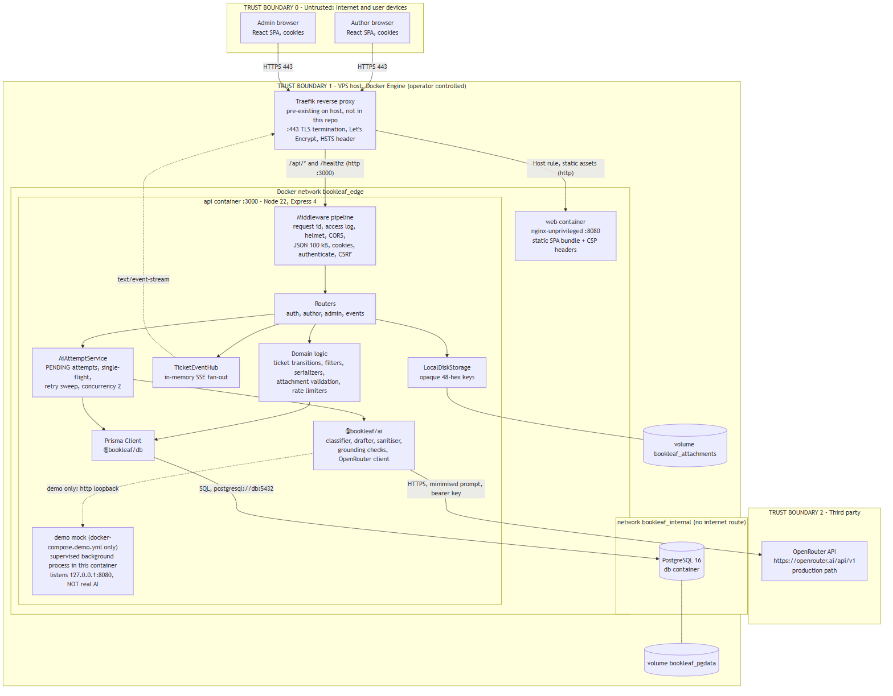

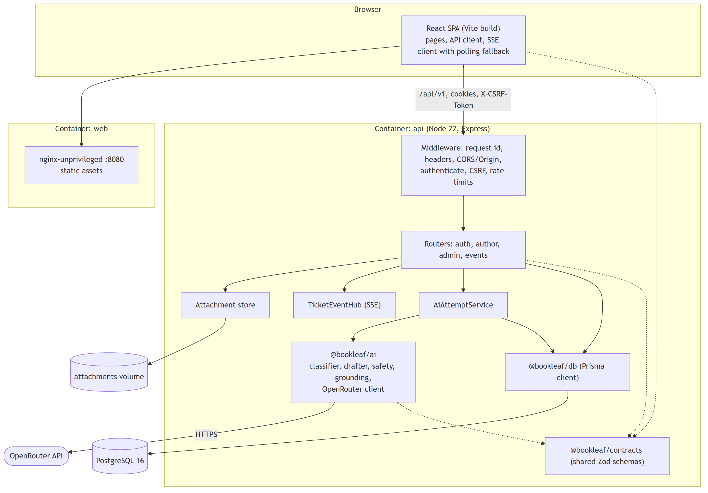

Diagrams are embedded as high-resolution images (zoom in the PDF for detail); editable Mermaid sources and SVGs are in `docs/architecture/diagrams/`.

Monorepo layout: `apps/web`, `apps/api`, `packages/contracts`, `packages/db`, `packages/ai`, `infra`, `docs`, `tests`.

## 6. Database design

Eleven tables. `User` has an optional one-to-one `AuthorProfile`; an author owns `Book`s and opens `Ticket`s (optionally about a book). A ticket owns messages, internal notes, assignments, attachments, AI analysis attempts and audit entries. `Session` rows belong to users. Enumerations: `UserRole` (AUTHOR, ADMIN), `TicketStatus` (OPEN, IN_PROGRESS, RESOLVED, CLOSED), `TicketCategory` (ROYALTY_PAYMENTS, ISBN_METADATA, PRINTING_QUALITY, DISTRIBUTION_AVAILABILITY, BOOK_STATUS_PRODUCTION, GENERAL_INQUIRY), `TicketPriority` (CRITICAL, HIGH, MEDIUM, LOW), `MessageVisibility` (AUTHOR, ADMIN), `AiAnalysisStatus` (PENDING, COMPLETED, FAILED).

Database-level protections include a trigger requiring a ticket's book to belong to the ticket's author, a trigger requiring assignees to be ADMIN users, and a partial unique index allowing one PENDING AI attempt per ticket. Deleting internal notes or assignments is **not** trigger-protected (known limitation).

### 6.1 Full ERD

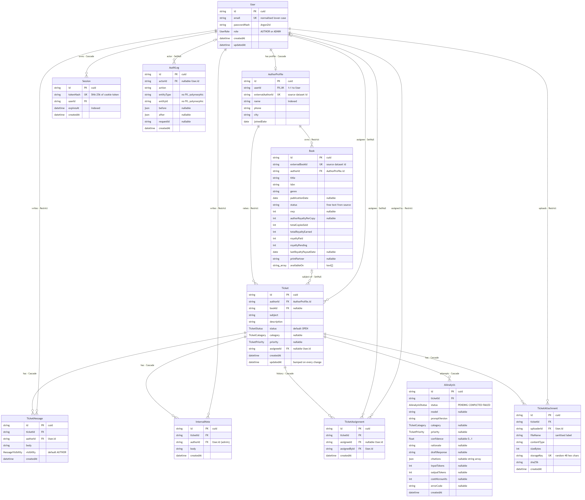

### 6.2 Simplified ERD

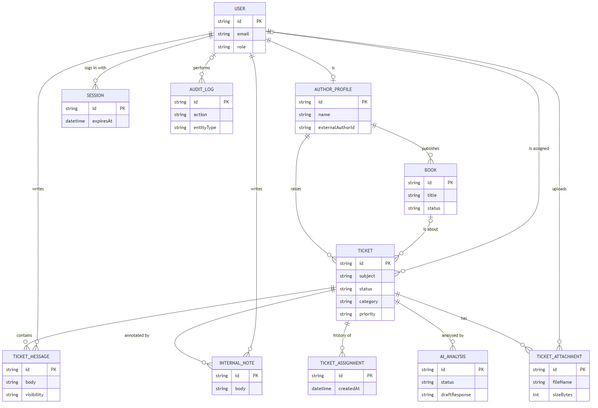

### 6.3 Domain class diagram

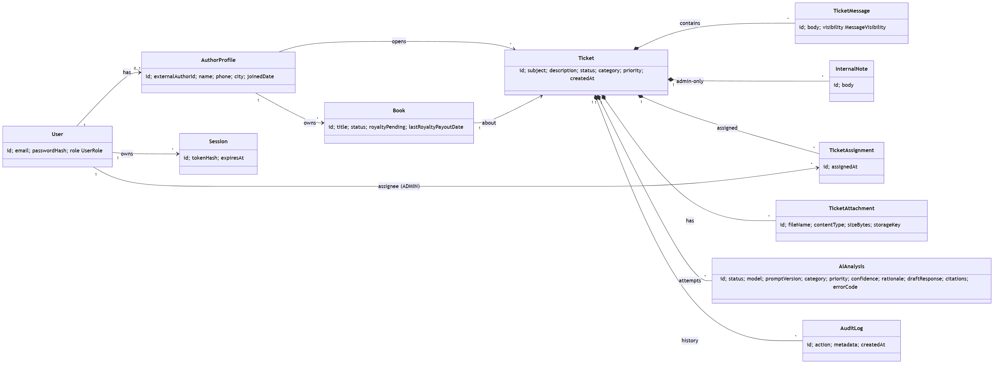

## 7. Data dictionary (summary)

Full column-level dictionary with types, keys, defaults and delete behaviour: `docs/architecture/04-DATA-DICTIONARY.md`.

| Table | Purpose | Key columns |
| --- | --- | --- |
| User | Login identity | id, email (unique, lower-case), passwordHash (Argon2id), role |
| AuthorProfile | Author details from the source dataset | id, userId (unique), externalAuthorId (unique), name, phone, city, joinedDate |
| Book | A book owned by an author | id, externalBookId, authorId, title, isbn, status, royalty figures, availableOn |
| Session | Server-side login session | id, tokenHash (SHA-256 of cookie token), userId, expiresAt |
| Ticket | A support request | id, authorId, bookId?, subject, description, status, category?, priority?, assigneeId? |
| TicketMessage | Conversation entry | ticketId, authorId, body, visibility |
| InternalNote | Admin-only note | ticketId, authorId, body |
| TicketAssignment | Assignment history | ticketId, assigneeId?, assignedById |
| TicketAttachment | Uploaded file metadata | ticketId, uploaderId, fileName, contentType, sizeBytes, storageKey (unique), sha256 |
| AiAnalysis | One AI attempt | ticketId, status, model, promptVersion, category, priority, confidence, rationale, draftResponse, citations, token counts, costMicrounits, errorCode |
| AuditLog | Change history | actorId?, action, entityType, entityId, before, after, requestId |

## 8. Data flow diagrams

### 8.1 Level 0 (context)

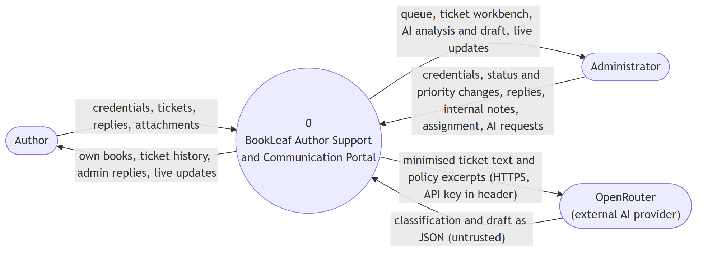

### 8.2 Level 1

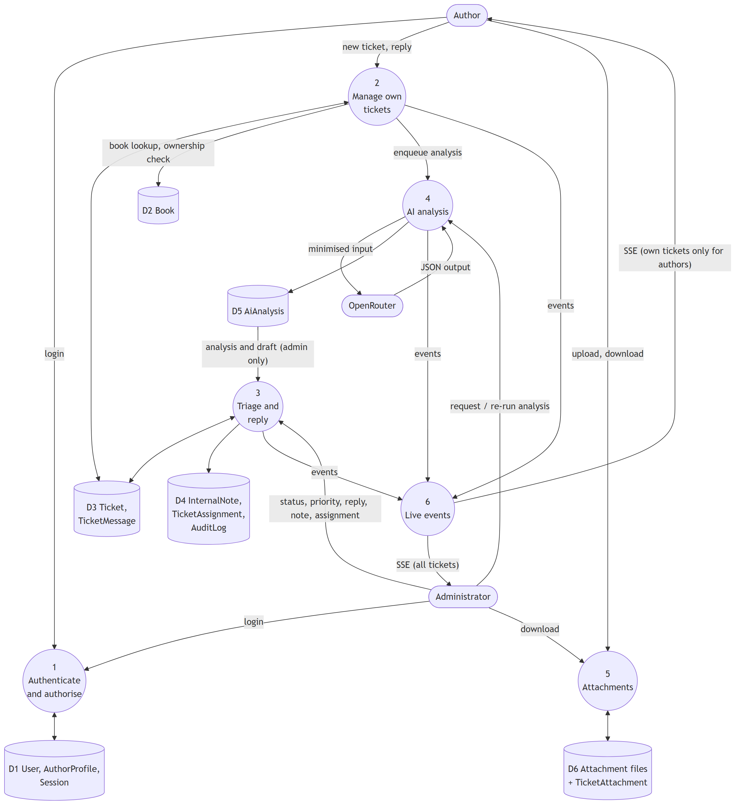

### 8.3 Level 2: ticket workflow

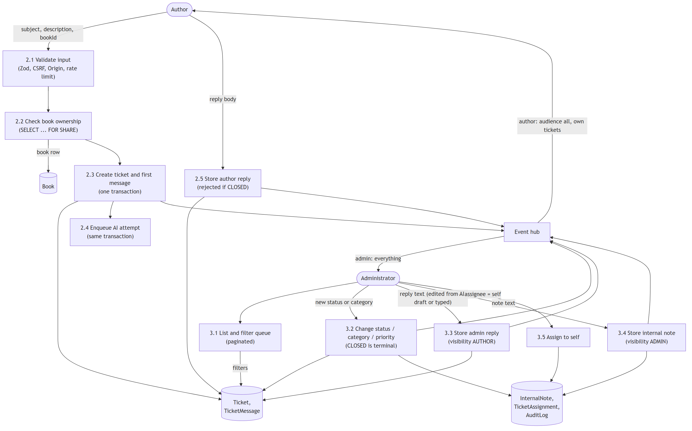

### 8.4 Level 2: AI workflow

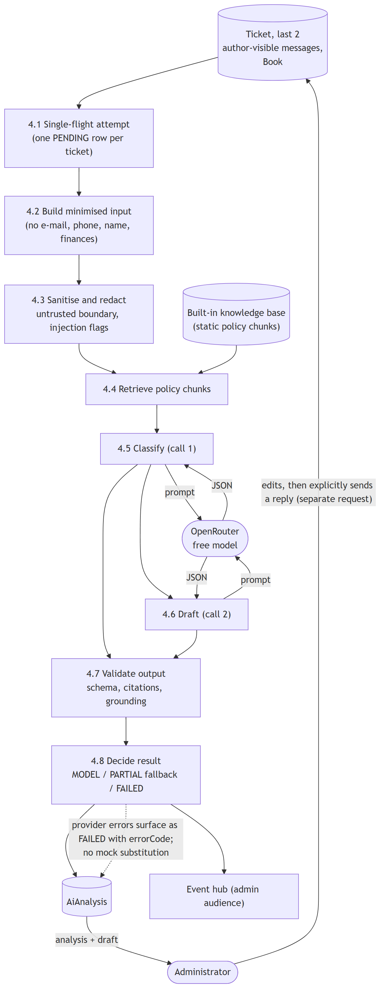

## 9. UML use cases

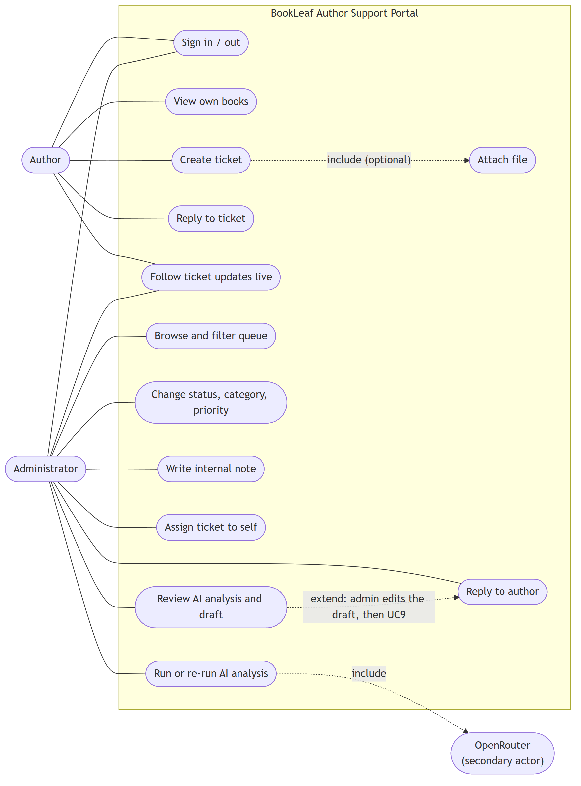

## 10. UML class diagram

See §6.3. The domain classes mirror the Prisma models; there are no inheritance hierarchies in the implementation.

## 11. UML activity diagram

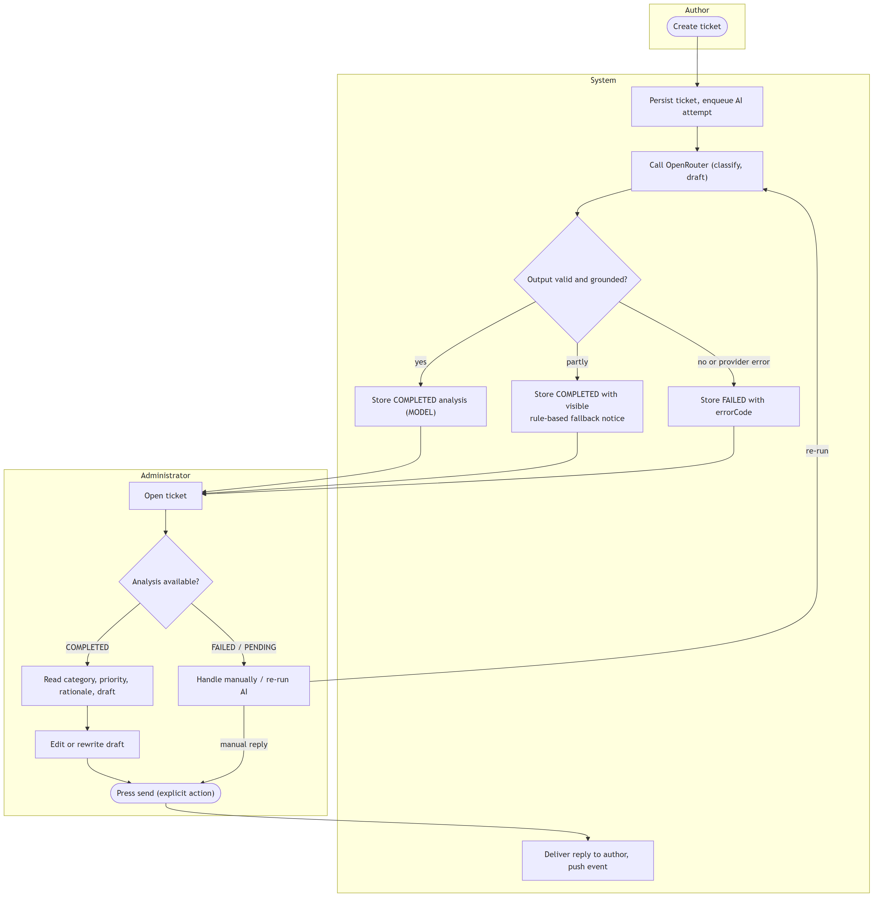

## 12. UML sequence diagrams

### 12.1 Ticket creation

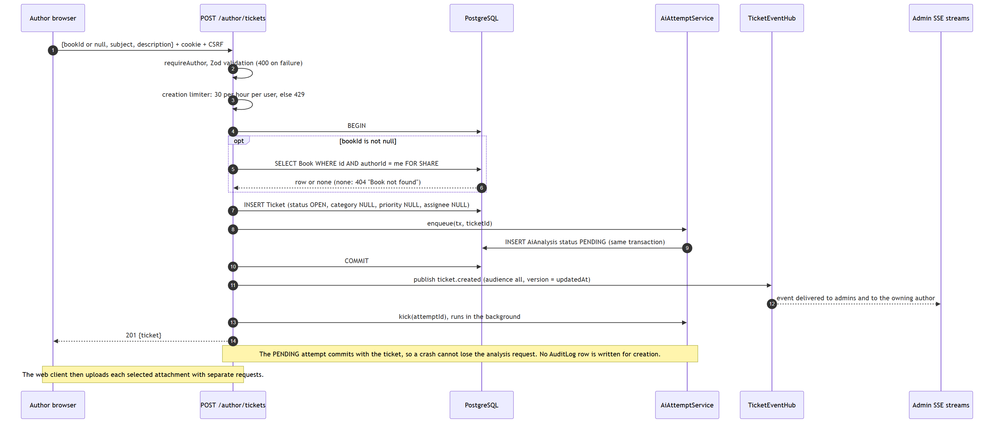

### 12.2 Conversation (reply, internal note, live event)

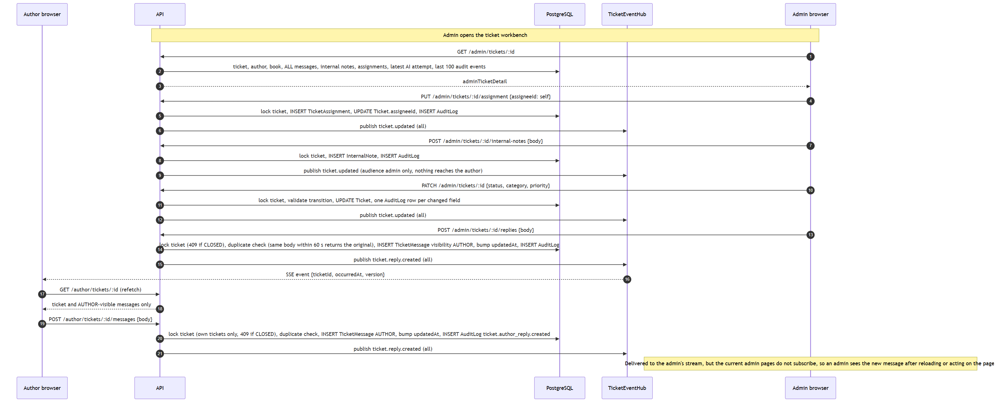

### 12.3 Login and session creation

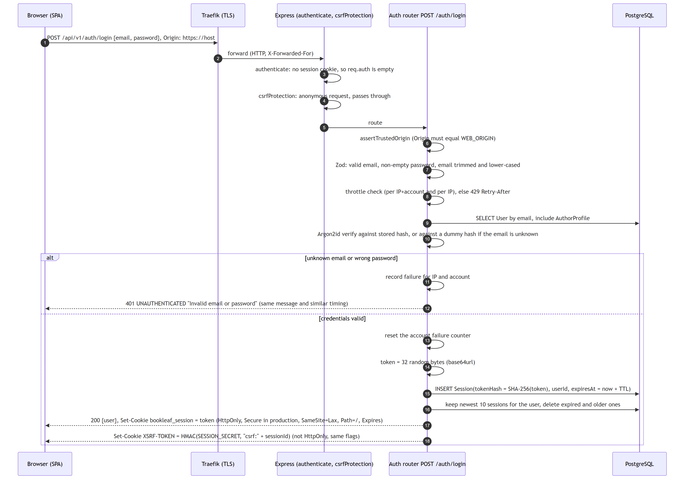

### 12.4 Author self-registration

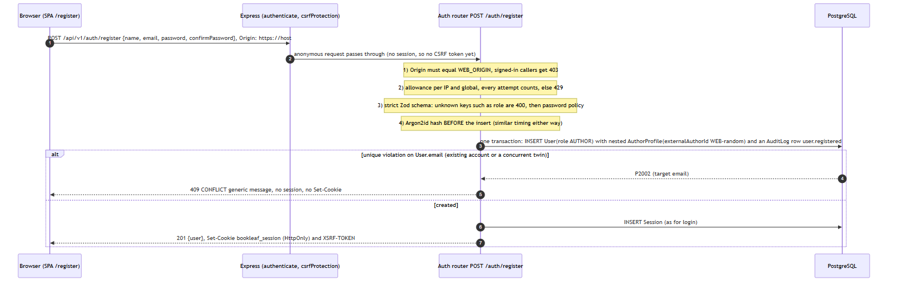

## 13. Ticket state transitions

Any non-CLOSED status can move to any other status through the admin `PATCH`. `CLOSED` is terminal: status, category, priority, replies, attachments, assignment and AI analysis answer `409`. Internal notes are still accepted on a closed ticket. Replies and notes never change status.

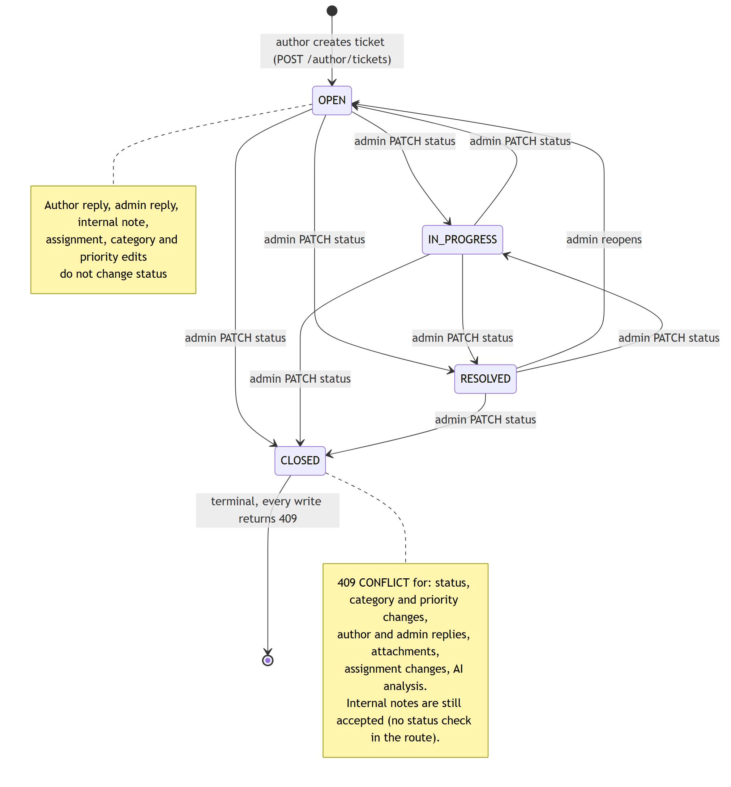

AI attempt states: PENDING, then exactly one of COMPLETED or FAILED. An attempt left PENDING beyond the worst-case window is closed as FAILED `AI_ATTEMPT_ABANDONED`.

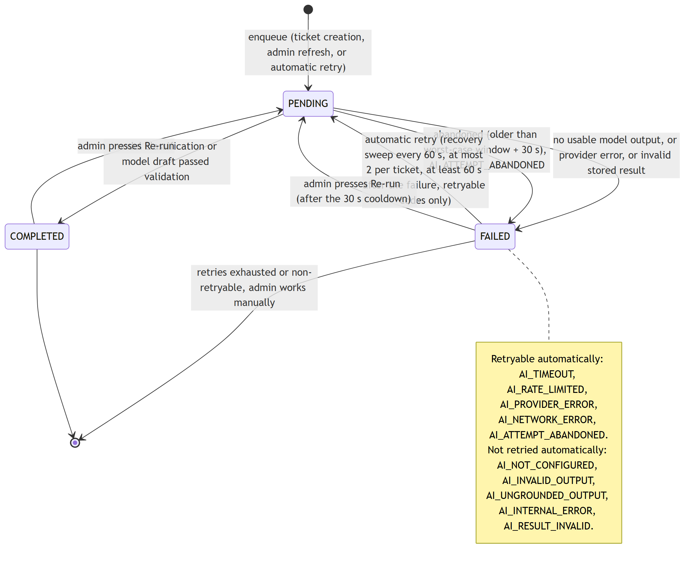

## 14. Authentication and authorisation

Model: server-side sessions with an opaque random cookie (`bookleaf_session`, HttpOnly, SameSite=Lax, Secure in production); only the SHA-256 of the token is stored. Passwords use Argon2id; unknown e-mails are verified against a dummy hash so timing and messages do not reveal accounts. A second cookie carries a session-bound CSRF token (an HMAC of the session id with `SESSION_SECRET`) that every state-changing request must echo in `X-CSRF-Token`, together with a trusted `Origin`. Login is throttled per IP and account. There is no JWT, OAuth or API-key authentication.

**Registration and the fixed admin role.** Authors register themselves at `/register` (`POST /auth/register`, §12.4). The endpoint accepts exactly four fields (name, e-mail, password, confirmation); any other field, including `role`, is rejected, and the server always stores `AUTHOR`. The password policy (12 to 128 characters with lowercase, uppercase and a digit, no very common passwords, no e-mail name) is shared by the form and the server, and passwords are hashed with the same Argon2id settings as login. Duplicates are decided only by the unique index on `User.email`, so concurrent registrations cannot create two accounts; the answer for an existing address is one generic `409`. Attempts are limited per IP (5 per hour) and globally (200 per hour). There is exactly one administrator, created and rotated only through the server-side tool `npm run admin:ensure` (credentials from the environment, never from a request, no default password, never promoting an author); no public API creates or modifies an admin.

Authorisation is role-based (`requireAuthor`, `requireRole(ADMIN)`) plus ownership scoping: an author's id comes only from the session and is part of every author query; a foreign resource returns the same `404` as a missing one. Admin-only data (internal notes, AI analysis) exists only on `/admin` routes.

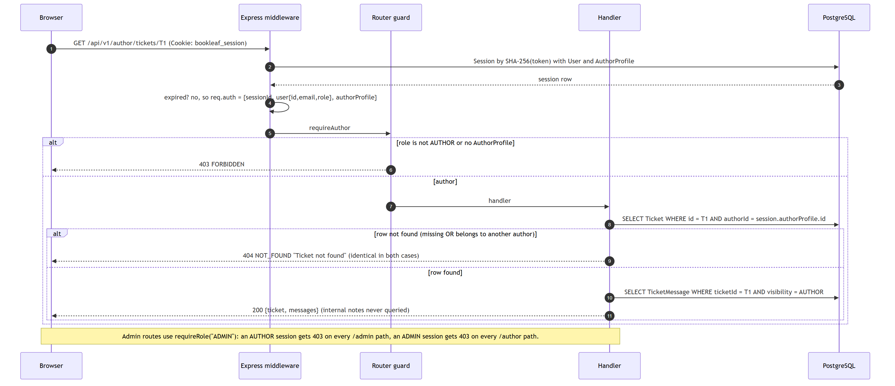

## 15. API architecture

Express application with a fixed middleware order (request id, security headers, JSON body limit 100 kB, authentication, CSRF, rate limits, validation, role guards, handlers) and Zod contracts shared with the frontend. Responses are JSON with `Cache-Control: no-store`; errors use one envelope with stable codes. There are **25 operations**: 24 under `/api/v1` and `GET /healthz`.

| Domain | Operations |
| --- | --- |
| Health | `GET /healthz` (liveness only) |
| Authentication | `POST /auth/login`, `POST /auth/register`, `POST /auth/logout`, `GET /auth/me` |
| Author books | `GET /author/books`, `GET /author/books/:bookId` |
| Author tickets | `POST /author/tickets`, `GET /author/tickets`, `GET /author/tickets/:ticketId`, `POST …/messages` |
| Author attachments | `POST`, `GET` list, `GET` one on `/author/tickets/:ticketId/attachments` |
| Admin tickets | `GET /admin/tickets`, `GET /admin/tickets/:ticketId`, `PATCH /admin/tickets/:ticketId` |
| Admin actions | `POST …/replies`, `POST …/internal-notes`, `PUT …/assignment` |
| AI | `GET /admin/tickets/:ticketId/ai-analysis`, `POST …/ai-analysis` (run or re-run) |
| Admin attachments | `GET` list, `GET` one |
| Events | `GET /events/tickets` (SSE) |

Full request/response detail: `docs/architecture/10-API-REFERENCE.md` and `docs/architecture/openapi.yaml`.

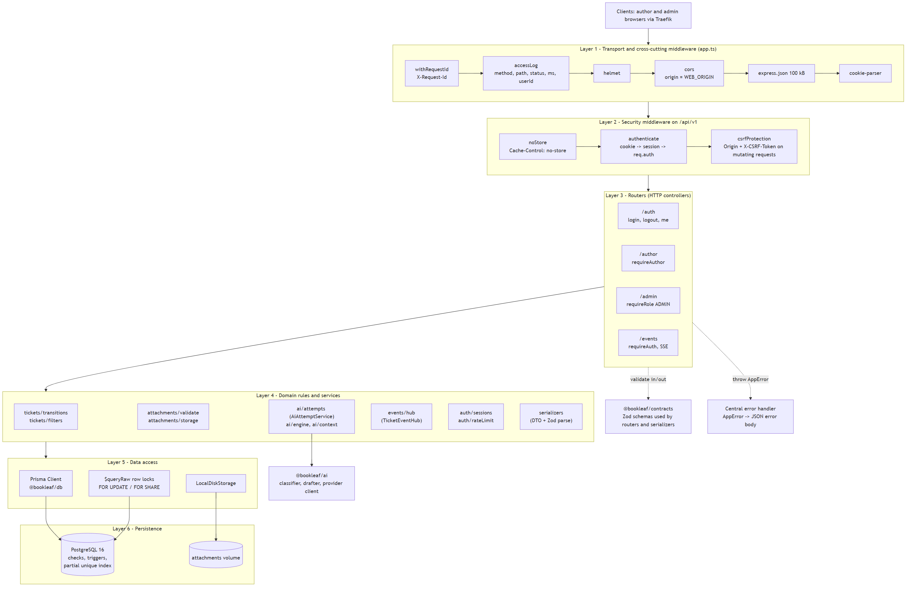

## 16. AI workflow (OpenRouter)

For each new ticket (and on admin request) the API creates a PENDING attempt in the ticket's transaction and runs it in the background (at most 2 concurrent). The `@bookleaf/ai` package then:

1. builds minimised input (subject, description, last two author-visible messages, minimised book facts; **no** e-mail, phone, name or financial figures; the author's first name is substituted locally after generation);
2. sanitises untrusted text (invisible characters, angle brackets, e-mail and long numbers redacted, random per-call boundary) and flags prompt-injection signals;
3. retrieves up to three policy chunks from a static knowledge base (keyword retrieval, no embeddings);
4. calls the model to **classify** (JSON), then to **draft** (JSON);
5. validates both outputs against schemas, cited policy ids and a grounding check (every number/date must come from the sources; no completed-action claims, links, refund promises, unsupported timeframes, payout promises, invented quoted menu/section names, or telling the author to reply to an e-mail);
6. stores the result: COMPLETED (model), COMPLETED with a visible *rule-based fallback* notice in the rationale when part of the model output was unusable, or FAILED with a stable error code (`AI_RATE_LIMITED`, `AI_TIMEOUT`, `AI_PROVIDER_ERROR`, `AI_NETWORK_ERROR`, `AI_INVALID_OUTPUT`, `AI_UNGROUNDED_OUTPUT`, `AI_NOT_CONFIGURED`, …).

Model output is treated as untrusted data. The package has no send capability; `requiresHumanReview` is the literal `true`.

Zero-spend controls: the default model is `nvidia/nemotron-3-super-120b-a12b:free` (`google/gemma-4-31b-it:free` is a supported alternative); against a real endpoint, configuration is rejected unless the primary and any fallback model ids end in `:free`; no paid fallback exists; retries are bounded (default 2) with jittered backoff and `Retry-After` respected; timeout 15 s; `max_tokens` capped (default 400); reasoning is disabled in requests so hidden reasoning tokens cannot exhaust the cap.

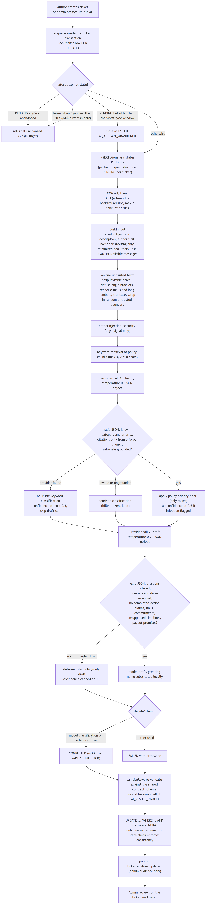

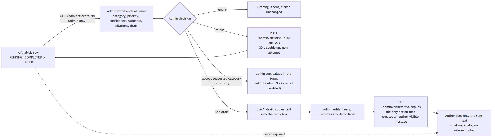

**Observed with a real free model (2026-10-16, synthetic tickets, account spend 0).** On the default `nvidia/nemotron-3-super-120b-a12b:free` with the final prompt: classification was correct for all six categories in every run, and the draft passed the strict validator in 12 of 13 analyses (it was 3 of 6 before prompt hardening), at 4-14 s per analysis and reported cost 0. The failures that remained were a model promising an unverifiable time frame or inventing a product feature, which the validator rejects and replaces with a labelled rule-based draft. The sample is small and non-deterministic. The Gemma alternative returned HTTP 429 from its upstream provider throughout and is unverified. Real failure handling was exercised against the live endpoint: rejected key (1 request, no retry), nonexistent model, paid-model configuration (0 requests) and a rate limit; none produced mock or paid output. Details, history and caveats: `docs/release/AI_REAL_PROVIDER.md`.

**Draft-quality hardening.** The knowledge base's tone guideline and royalty style example contain illustrative promises such as "within 48 hours", which real models copied and the grounding check rejected. The knowledge-base text was **not** rewritten, because it could not be verified as an operational commitment; the prompt now labels those blocks as style-only illustrations, masks durations inside them (policy excerpts are never masked), and tells the model what to do when facts are missing (acknowledge, say what the team will verify, commit to no dates, amounts, response times or distribution).

## 17. Mock versus real provider modes

| | Real provider (default) | Demonstration mock (opt-in) |
| --- | --- | --- |
| Enabled by | `OPENROUTER_API_KEY` in `infra/.env`; base URL left at the default | `infra/docker-compose.demo.yml` **and** `MOCK_AI_ACK=demonstration-only` |
| Endpoint | `https://openrouter.ai/api/v1` | `http://127.0.0.1:8080` inside the api container |
| Output | Language-model text | Canned, keyword-matched text labelled `[DEMO MOCK]` / `[DEMO DRAFT]`; no inference |
| Model guard | `:free` ids only | exempt (no billable calls) |
| On failure | Attempt FAILED with an error code | n/a |

The system never substitutes mock output for a failed real call. Since 2026-10-16 the staging site runs the **real provider** (mock disabled); the demonstration mock remains an opt-in override only.

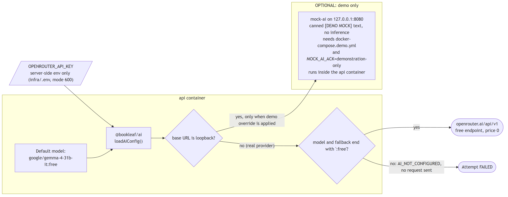

## 18. Attachment handling

Authors upload files to their own tickets (client and server check: non-empty, at most 5 MB, type in an allow-list, magic bytes matching the declared type, sanitised filename). Files are stored on a Docker volume under random keys with a SHA-256; metadata is in `TicketAttachment`. Downloads are forced (`Content-Disposition: attachment`, `nosniff`, a restrictive CSP) and authorised by ownership (author) or role (admin). Deletion is not implemented.

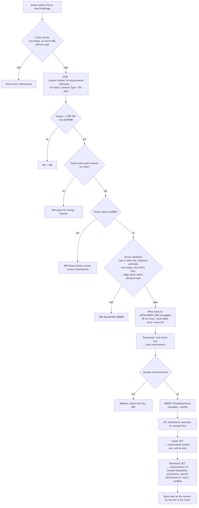

## 19. Real-time updates: SSE and polling

`GET /events/tickets` is a Server-Sent Events stream. An in-process hub fans out events after each change; admins receive everything, authors only events for their own tickets, and AI and internal-note events are admin-only. The browser reconnects with `Last-Event-ID` and the server replays tickets changed since then; the stream asks for a 5 s retry. If the stream is unavailable the client falls back to a 25 s poll and stops polling when SSE recovers. The hub is per process (single API instance).

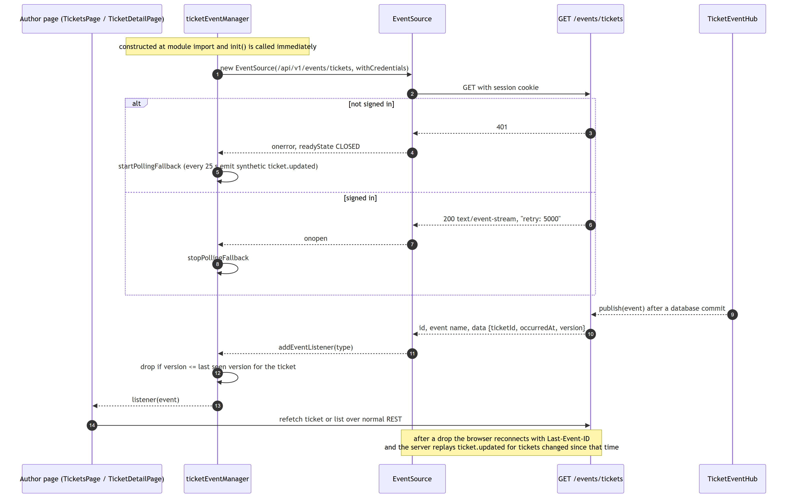

## 20. Security design

Layers: host firewall (22, 80, 443) → Traefik TLS and HSTS → API origin check → session authentication → CSRF → rate limits (login; registration; ticket creation 30 per hour per user; replies) → Zod validation (unknown query keys rejected) → role guard → ownership scoping → database constraints and triggers. Secrets exist only in server environment files; the API refuses placeholder secrets in production; the OpenRouter key never reaches the browser, logs, database rows or API responses (verified by tests with a fake key).

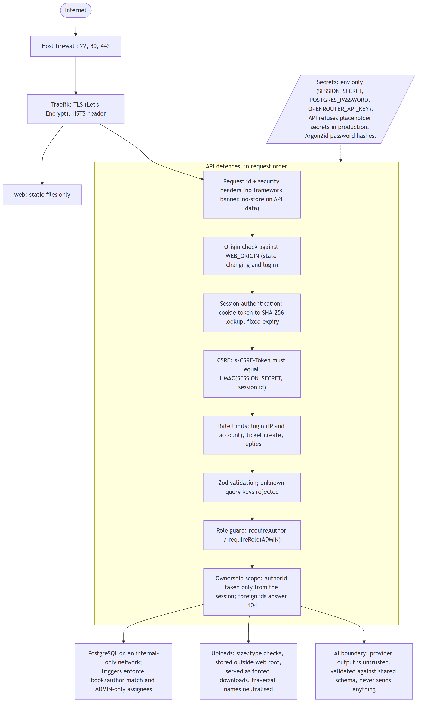

Residual risks: free AI endpoints may retain prompts (only synthetic data was used in testing); login and registration throttling is in memory; one API instance; registration reveals whether an address is already registered (no e-mail verification); self-registered authors are not verified people, so book linkage must stay a manual administrative decision.

Data hygiene controls: the production seed refuses synthetic accounts (`NODE_ENV=production` without an explicit acknowledgement), and a dry-run-by-default cleanup tool removes only provably synthetic records, never the admin and never audit history (`docs/release/FINAL_CLEANUP_INVENTORY.md`).

## 21. Docker and VPS deployment

Compose project `bookleaf` with services `db` (postgres:16-alpine, internal network only), `api` and `web`, plus one-shot `migrate` and `seed` jobs. Traefik (shared, outside this repository) terminates TLS and routes the host and `/api/` and `/healthz`. Secrets come from `infra/.env` (mode 600, git-ignored). Read-only inspection on 2026-10-16 found all BookLeaf containers healthy, TLS valid until 2027-01-13, disk 30% used, and only ports 22/80/443 exposed.

Deployment findings to act on: a host cron prunes unused Docker images older than 24 h (can delete rollback images); the deployed source tree is not a git checkout; a reboot is pending. Deployment procedures and the prepared (not executed) release plan are in `infra/DEPLOY.md` and `docs/release/`.

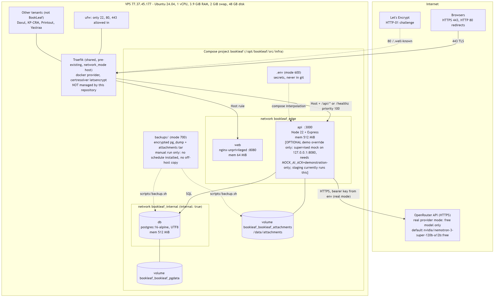

## 22. Backup and recovery

`infra/scripts/backup.sh` writes an encrypted (AES-256, PBKDF2) custom-format database dump and an attachments archive, verifies them (decrypt, `pg_restore --list`, `tar t`, SHA-256 manifest), rotates 7 daily / 4 weekly / 3 monthly sets, records `last-status.json`, can alert a webhook and can upload to an rclone destination. `restore-test.sh` restores into a disposable container. **Status:** tested locally with disposable containers only (550-row restore, wrong passphrase and tampered archive rejected, retention). Installed on the VPS (daily 02:30 UTC cron, weekly restore test) on 2026-10-16; a restore of a backup of the live database was proven in a disposable container (119 tickets, 25 attachments, 122 AI attempts matched). No off-host destination exists, so backups are local-only; the first scheduled run is not yet observed. Recovery objectives are targets, not guarantees. See `docs/operations/BACKUP_AND_RECOVERY.md` and `DISASTER_RECOVERY.md`.

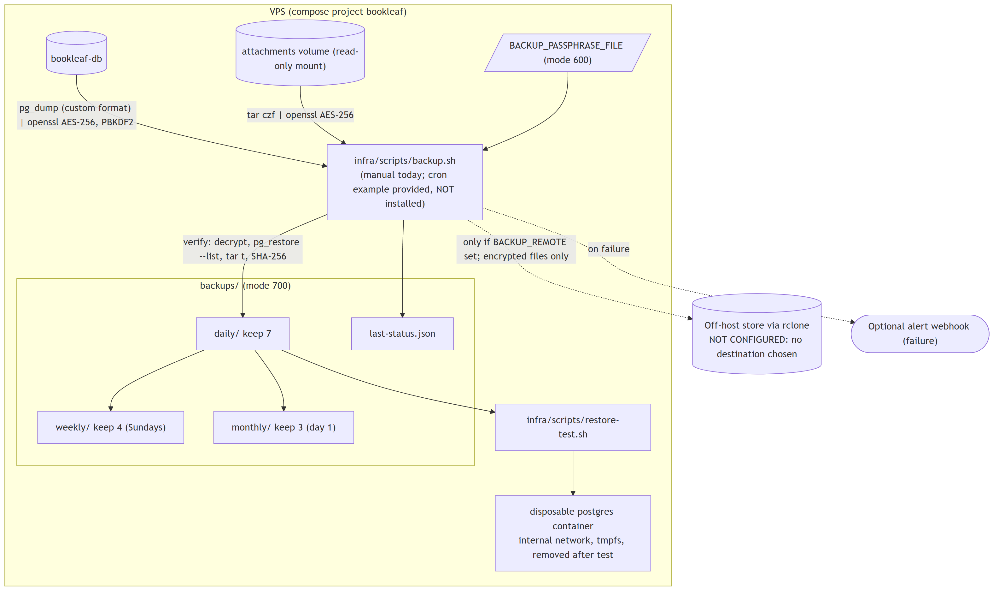

## 23. Testing strategy and results

| Layer | Tool | Result (this branch) |
| --- | --- | --- |
| AI package | Vitest | 485 passed |
| API with real PostgreSQL | Vitest + Supertest | 292 passed, 0 skipped (42 registration, 20 cleanup/seed-guard/admin-tool) |
| Frontend | Vitest + Testing Library | 68 passed (15 registration form) |
| Browser E2E | Playwright (Chrome) on a disposable stack with a mock provider | 41 passed (11 registration: desktop, 375 px mobile, keyboard) |
| Scaffold / infra | `node --test` | 9 / 12 passed |
| Backup scripts | manual, disposable containers | passed (see §22) |
| Real OpenRouter | `tests/live/ai-real.mjs`, `ai-real-failures.mjs` | classification 6/6; drafts accepted 12/13 on the final prompt; failure scenarios passed (see §16) |
| Live production checks | `tests/live/*` and ad-hoc scripts, 2026-10-16 | 10/10 original-author logins with exact book ids, cross-author read 404, author blocked from admin API, self-registration, ticket, admin note, override and reply, author receipt, internal note hidden (13/13); no AI calls (quota exhausted) |

Regression tests were added for each fix made in this release (whitespace login e-mail, signed-in redirect from `/login`, fallback labelling, model-greeting handling, zero-spend guard). All automated AI tests use mock or scripted providers.

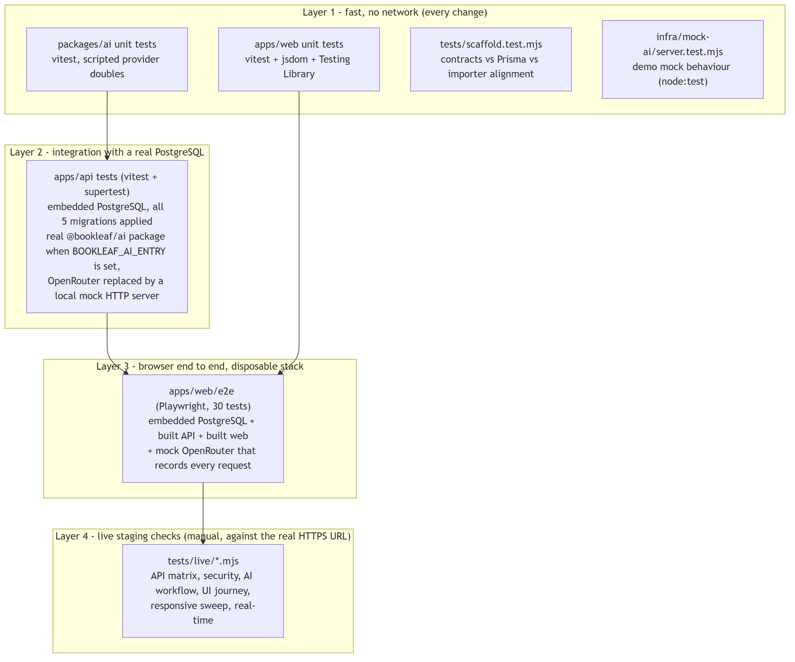

## 24. Known limitations

* Real AI is verified with limits: small, non-deterministic sample (12 of 13 drafts accepted); the Gemma alternative was rate limited upstream; free models rate-limit (20/min, 50/day documented without credits) and may retain prompts; the validator cannot judge semantic quality, so human review is essential.
* The knowledge base's tone guideline and royalty example suggest quoting "within 48 hours"; this is unverified as a real commitment, the AI is told not to repeat it, and the policy text was not changed. If it is a real commitment it should be added to a policy chunk.
* Real AI on the live site is unverified because the free daily quota (50 requests) was exhausted during acceptance; a key without purchased credits supports about 25 analyses a day.
* Backups are installed and scheduled, with a restore proven in isolation, but there is no off-host copy, so disaster recovery is incomplete; the first scheduled run is not yet observed.
* Host risks: image-prune cron, pending reboot and updates, deployed tree not a git checkout.
* Deferred defects: duplicate tickets on concurrent identical submissions; admin search covers the current page only; health endpoint is liveness-only; internal-note/assignment deletion not trigger-protected (needs a migration).
* Not implemented: password reset, e-mail notifications, e-mail verification of new accounts, attachment deletion, server-side search.
* Self-registered authors start with no books: there is no admin screen or API to link books to an account yet (done by a database operation), and registration reveals whether an address is already registered.
* Registration is live and was exercised on the production site; the production database still holds older synthetic test records (inventory: `docs/release/CLEANUP_INVENTORY_2026-10-16.md`) until a separately approved cleanup is run.
* Single API instance: login throttling, event hub and AI single-flight are per process.

## 25. Conclusion

The portal implements the full author-to-admin support workflow with strong tenant isolation, a defence-in-depth security model, and an AI assistant that is advisory only, grounded in policy and fail-closed. Local automated verification is extensive and green. Remaining work before calling it production-ready: repeat real-provider verification at larger scale and on the deployed site, install and prove the backup chain with an off-host copy, secure the rollback images, and run the planned deployment.
