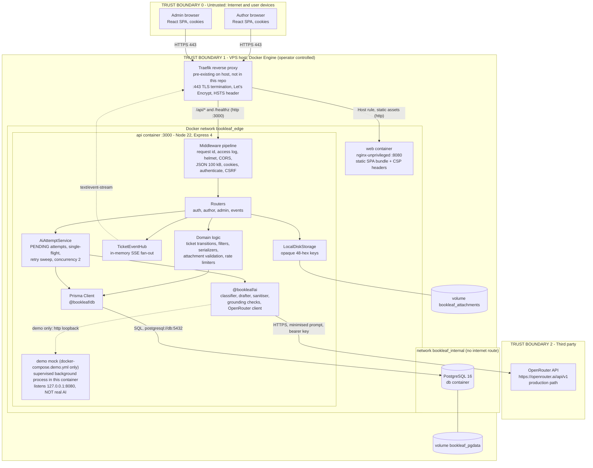

# 2. High-Level System Architecture

## 2.1 System context and trust boundaries

**Explanation.** The diagram shows the three trust zones that matter for security analysis.

* **Boundary 0 (Internet / browsers).** Everything a browser sends is untrusted: JSON bodies, query strings, cookies, uploaded bytes and `Origin` headers are validated in the API. The API never relies on client-side checks: the React route guard is a usability feature, not a security control.
* **Boundary 1 (VPS host).** Traefik terminates TLS and forwards plain HTTP over the Docker `edge` network. The API is attached to both `edge` and `internal`; PostgreSQL only to `internal`, a Compose network declared `internal: true` that has no route to the internet. No container publishes a host port (checked in `infra/docker-compose.yml`).
* **Boundary 2 (OpenRouter).** The only outbound data flow that leaves the operator's control. Only a minimised prompt crosses it (see [09 – AI Architecture](09-AI-ARCHITECTURE.md), §9.7). The OpenRouter box is the **production-compatible path**; it is implemented and unit-tested against local mock HTTP servers, but **no real OpenRouter request has ever been made with a key** by this project (`KNOWN_LIMITATIONS.md`, release audit §6).
* **Staging demo mock.** The demo mock is drawn inside the API container with a dashed line because it exists only when the opt-in `docker-compose.demo.yml` override is applied, only on staging, and runs as a supervised background process of the API container. It is not a separate container, so it shares the API's lifecycle and cannot be stranded by an API restart or recreate. It is a keyword matcher returning canned text, not a language model.

## 2.2 Component responsibilities

| Component | Technology (from source) | Responsibility |
| --- | --- | --- |
| Author browser / Admin browser | Any modern browser; Chromium only is test-covered | Runs the same React SPA; role decides which routes render. Holds an `HttpOnly` session cookie and a JS-readable CSRF cookie |
| Traefik | Docker-label routing on the host's existing instance (version not in repo) | TLS termination with the `letsencrypt` resolver; routes `Host(...)` + `PathPrefix(/api/)` or `Path(/healthz)` to the API (priority 100) and the rest of the host to `web`; adds `Strict-Transport-Security: max-age=31536000`. Static Traefik configuration (entrypoints, HTTP→HTTPS redirect) is **not in the repository** |
| `web` container | `nginxinc/nginx-unprivileged:1.27-alpine`, built from `apps/web` with Vite 6 | Serves the compiled React bundle on `:8080` with a strict Content-Security-Policy, `X-Frame-Options: DENY`, `nosniff`, `Referrer-Policy`, `Permissions-Policy`; SPA fallback to `index.html`; immutable caching for `/assets/` |
| React frontend (`apps/web`) | React 18.3, TypeScript, React Router 7, Tailwind 3, Zod | UI for authors and admins; typed API client validating every response with the shared Zod contracts; SSE client with polling fallback. See [06](06-FRONTEND-ARCHITECTURE.md) |
| API (`apps/api`) | Node 22 (Docker), Express 4.21, helmet 8, cors, cookie-parser, Zod | HTTP interface, authentication, authorisation, validation, business rules, orchestration. See [05](05-BACKEND-ARCHITECTURE.md) |
| Authentication / session layer | `auth/*` in the API; Argon2id (`@bookleaf/db`) | Password verification, opaque server-side sessions, CSRF token, origin check, login throttling |
| Business logic | `tickets/*`, `attachments/*`, route handlers | Ticket state machine, filters and queue ordering, attachment validation, duplicate-submission handling, audit rows |
| Database access layer | Prisma Client 6 (`@bookleaf/db`), plus `$queryRaw` for row locks (`SELECT … FOR UPDATE/SHARE`) and the queue's ordering SQL | All persistence; transactions group state change + audit row |
| PostgreSQL | `postgres:16-alpine`, UTF-8, 512 MiB limit | System of record; also enforces integrity via checks, triggers and a partial unique index |
| Attachment storage | `LocalDiskStorage` on named volume `bookleaf_attachments` mounted at `/data/attachments` | Stores uploaded bytes under random keys, mode `0600`, `wx` (never overwrite). The `AttachmentStorage` interface allows another backend later; none exists |
| AI integration layer | `@bookleaf/ai` workspace package + `apps/api/src/ai/*` | The API owns durable attempts, concurrency, retry and privacy allow-listing; the package owns prompts, sanitising, retrieval, validation and the provider client. See [09](09-AI-ARCHITECTURE.md) |
| OpenRouter provider | `OpenRouterProvider` (chat completions, `response_format: json_object`) | Production LLM inference. Disabled until `OPENROUTER_API_KEY` is set; until then analyses record `AI_NOT_CONFIGURED` instead of calling anything |
| Staging mock-AI | `infra/mock-ai/server.mjs`, run by `docker-compose.demo.yml` inside the API container (same image and user `node`; code mounted read-only) | Demonstration stand-in; refuses to start without `MOCK_AI_ACK=demonstration-only`; labels every output `[DEMO MOCK …]` / `[DEMO DRAFT …]` |
| Server-Sent Events | `routes/events.ts` + `events/hub.ts` | One-way push of `{ticketId, occurredAt, version}` to the right users; catch-up from the database after reconnect |
| Docker containers | Compose project `bookleaf` | `db`, `api`, `web` always; `migrate`, `seed` (profile `tools`, one-shot). There is no mock container: the demo mock is a process inside `api` |
| Persistent volumes | `bookleaf_pgdata`, `bookleaf_attachments` | Survive `docker compose down` (removed only with `-v`) |

## 2.3 Production path versus staging demonstration

| Aspect | Production-compatible path | Staging demo (opt-in) |
| --- | --- | --- |
| Provider | OpenRouter at `OPENROUTER_BASE_URL` (default `https://openrouter.ai/api/v1`), `https` required | `infra/mock-ai`, plain `http://127.0.0.1:8080/api/v1` (the AI package accepts `http` only for `127.0.0.1`/`localhost`) |
| Enabled by | Real `OPENROUTER_API_KEY` | `-f docker-compose.yml -f docker-compose.demo.yml` (the override sets the dummy key, `OPENROUTER_MODEL=demo/mock-not-a-real-model`, `MOCK_AI_ACK`) |
| Output | Real model completion, then schema/grounding validation | Canned keyword-matched text, then the **same** schema/grounding validation |
| Verified | Provider client against local mock servers (unit tests); never against the real service | Staging behaviour verified by the release audit (34/34 checks) |
| Proves model quality? | Not yet tested | **No.** It exercises the pipeline, persistence and review UI only |
| Default | Off when no key is set (analyses fail safely with `AI_NOT_CONFIGURED`) | Not part of the default service set |

## 2.4 What is deliberately not in the architecture

The repository contains **no** message queue, cache server, worker process, microservice, object store, email service, WebSocket server, JWT/refresh-token flow or external identity provider. Background AI work runs inside the API process (`AiAttemptService.kick`) with durable `PENDING` rows in PostgreSQL; the recovery sweep also runs in-process on a timer. `docs/ARCHITECTURE.md` refers to an "AI worker/service" and to attachments being "UI-only"; both phrases predate the implementation and no longer match the code (see [17](17-KNOWN-LIMITATIONS.md), discrepancy table).

## 2.5 Status legend used throughout these documents

| Label | Meaning |
| --- | --- |
| **Implemented** | Present in source at the documented revision |
| **Tested** | Covered by an automated suite whose result is recorded in `RELEASE_AUDIT_REPORT.md` (2026-10-15, SHA `3b09980`) |
| **Deployed** | Observed running on the staging VPS by that audit |
| **Planned / not implemented** | Mentioned in a comment, doc or UI text but absent from the code |
| **Limitation** | Known constraint, documented in [17](17-KNOWN-LIMITATIONS.md) |
