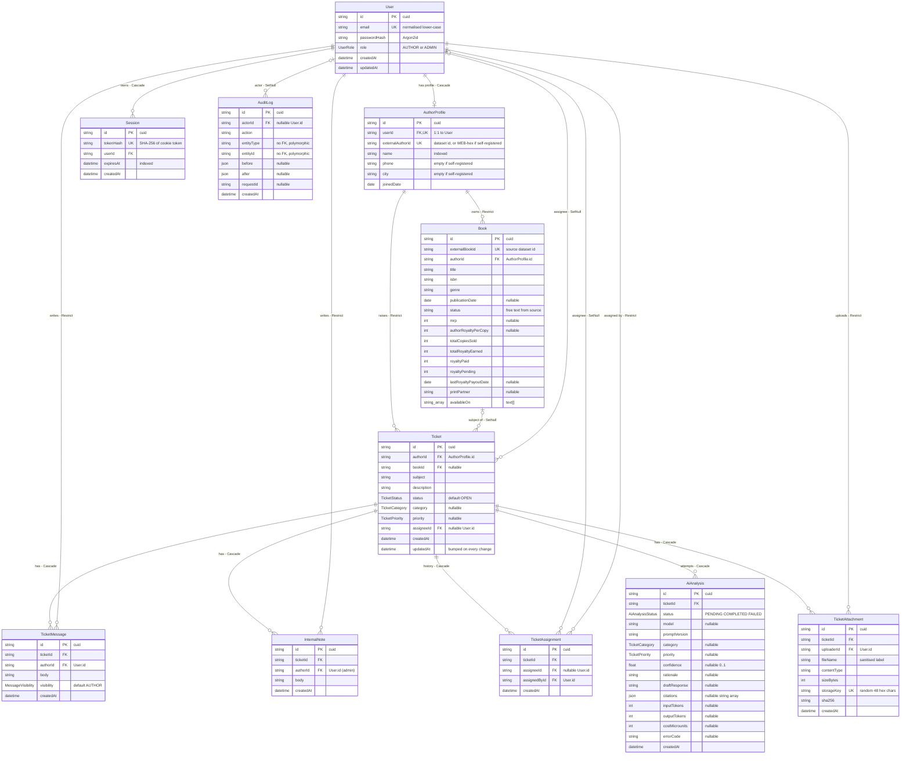
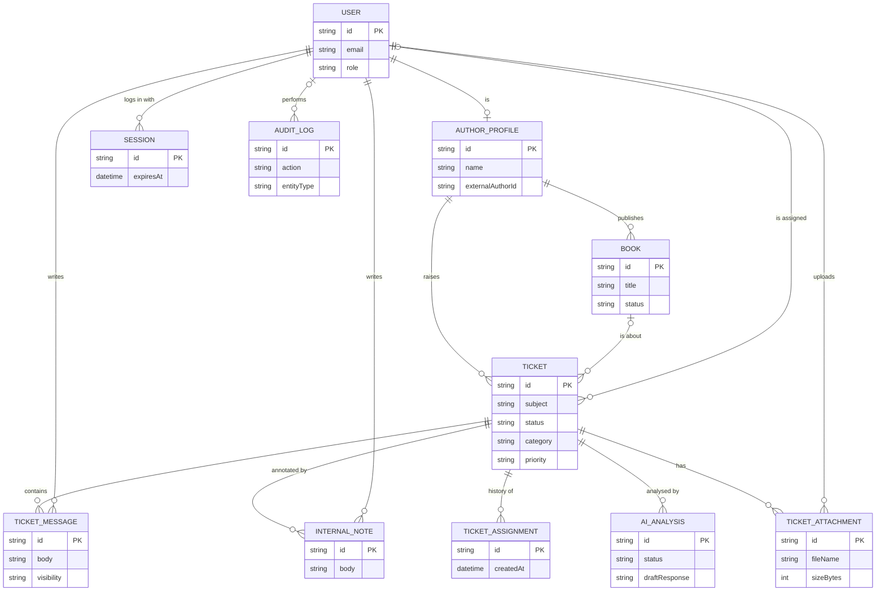
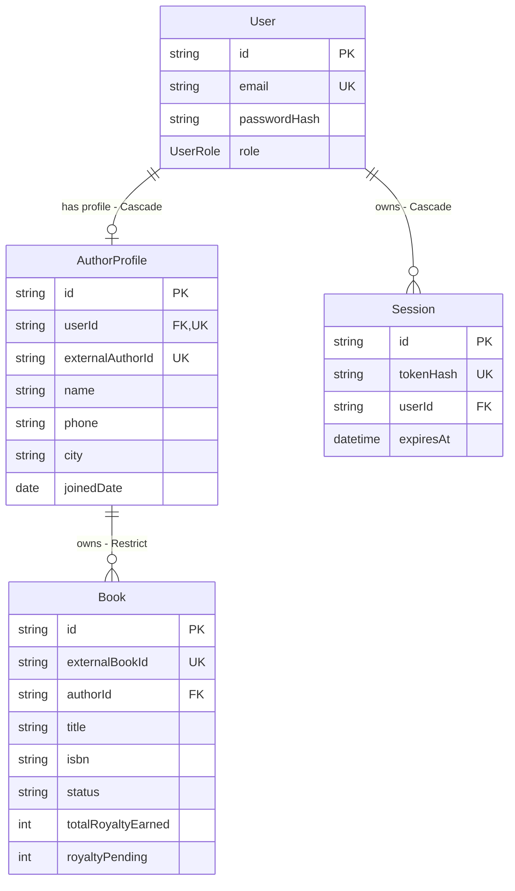
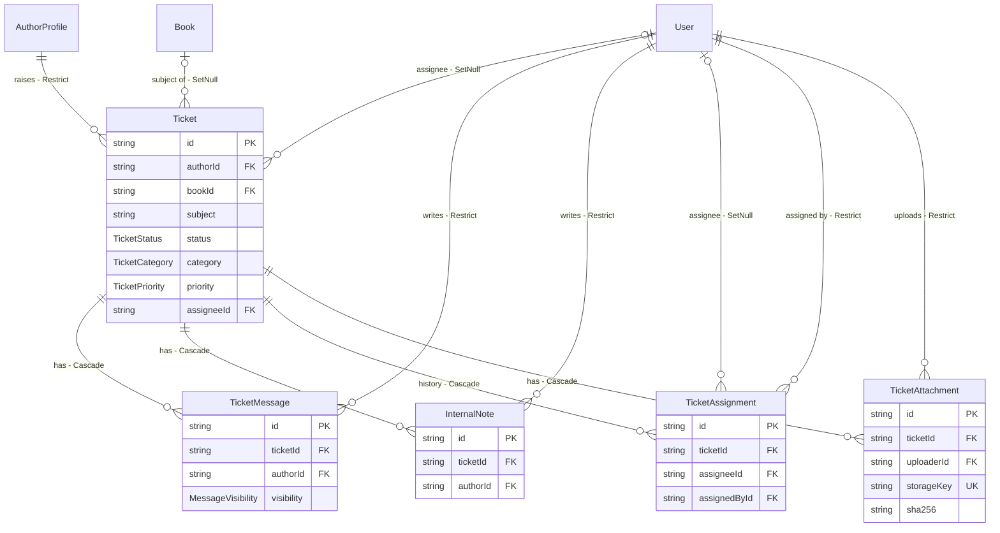
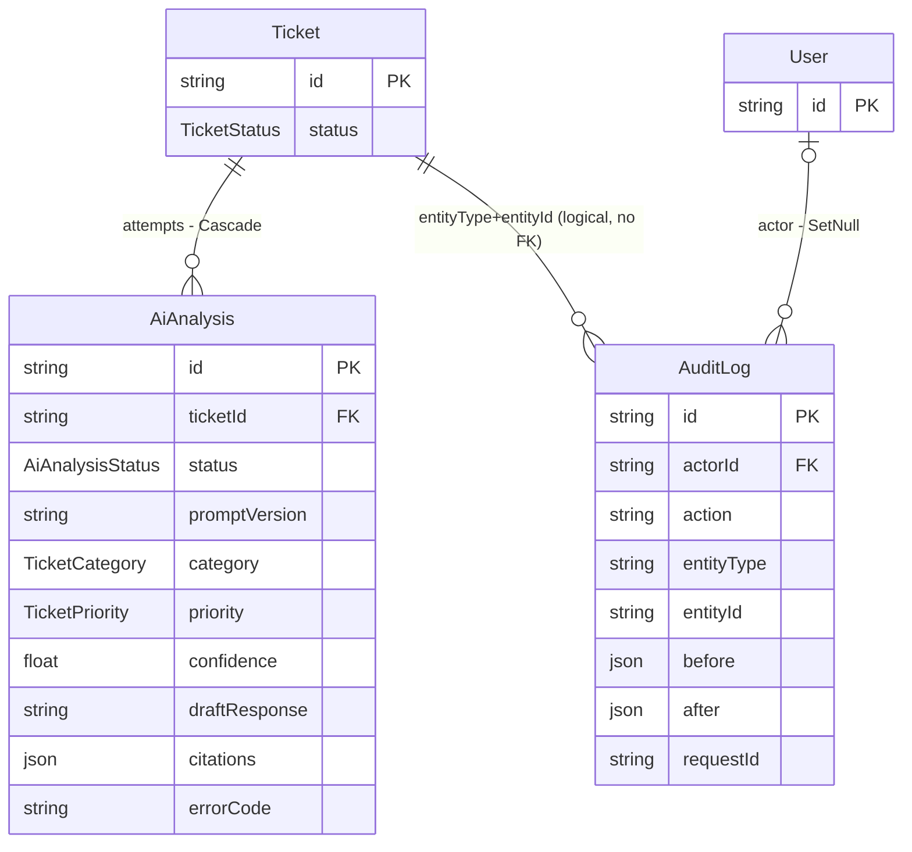

# 3. Database Design and Entity Relationship Diagrams

> Source of truth: [`packages/db/prisma/schema.prisma`](../../packages/db/prisma/schema.prisma) and the five SQL migrations in
> [`packages/db/prisma/migrations/`](../../packages/db/prisma/migrations). Database: PostgreSQL 16 (`postgres:16-alpine` in Compose), accessed through Prisma 6 (`@prisma/client ^6.4.1`).
> Attribute-level detail is in [04 – Data Dictionary](04-DATA-DICTIONARY.md).

The schema has **11 persistent models** (tables) and **6 enums**. There are no join tables: every relationship is a plain one-to-many or one-to-one foreign key. The count was checked by listing every `model` block in `schema.prisma` (User, AuthorProfile, Book, Session, Ticket, TicketMessage, InternalNote, TicketAssignment, AiAnalysis, AuditLog, TicketAttachment).

Five migrations, applied in order:

| Migration | Purpose |
| --- | --- |
| `20261014000000_init` | Tables, enums, foreign keys, indexes |
| `20261014000100_integrity_checks` | `CHECK` constraints (email normalised, non-negative money, session expiry, non-blank text, `AiAnalysis` state invariants) and the append-only `AuditLog` trigger |
| `20261014000200_ticket_attachments` | `TicketAttachment` table, size/name checks, trigger `Ticket_book_author` (a ticket's book must belong to the ticket's author) |
| `20261014000300_ai_single_flight` | Partial unique index `AiAnalysis_one_pending_per_ticket` (at most one `PENDING` attempt per ticket) |
| `20261014000400_role_and_history_guards` | Triggers: assignees/assigners/note authors must be `ADMIN`; `InternalNote` immutable; `TicketAssignment` append-only; `ADMIN`-visibility messages must come from an admin |

Prisma cannot express partial indexes, `CHECK` constraints or triggers, so these live only in SQL migrations and do not appear in `schema.prisma`.

## 3.1 Master ER diagram (all 11 entities, all attributes)

Notation: Mermaid `erDiagram` crow's-foot. `||` exactly one, `o|` zero or one, `o{` zero or many. `PK` primary key, `FK` foreign key, `UK` unique. The text in quotes on a relationship is the foreign-key delete rule (`Cascade`, `Restrict`, `SetNull`) as declared in the schema.

**Reading the diagram.** `User` is the root of identity. An `AUTHOR` user has exactly one `AuthorProfile` (a `User` may have none, which is the case for `ADMIN` users). Authors own `Book`s and raise `Ticket`s; a ticket may optionally reference one of that author's books. Each ticket accumulates `TicketMessage`s (author-visible conversation), `InternalNote`s (admin-only), `TicketAssignment` history rows, `AiAnalysis` attempts and `TicketAttachment`s. `AuditLog` records who did what; it points at its subject through `entityType` + `entityId`, which are deliberately **not** foreign keys (the log must survive deletion of the subject, and the table is append-only).

Two identifier spaces coexist and are easy to confuse: `Ticket.authorId` and `Book.authorId` hold an **`AuthorProfile.id`**, while `TicketMessage.authorId`, `InternalNote.authorId`, `TicketAssignment.*Id`, `TicketAttachment.uploaderId` and `AuditLog.actorId` hold a **`User.id`**. (`docs/API_CONTRACT.md` makes the same point.)

## 3.2 Simplified academic ER diagram

Only entity names, primary keys and the attributes needed to understand the model. Suitable for a one-page figure.

The simplified diagram renames entities to upper-case academic style (`TICKET_MESSAGE` = model `TicketMessage`). It omits foreign-key attributes; they are in the master diagram.

## 3.3 Domain-split diagrams

The master diagram is complete but dense. The same entities are shown again by domain; every relationship above appears in at least one of the following.

### Identity and catalogue

### Ticketing

### AI analysis and audit

In this last diagram the `Ticket ||--o{ AuditLog` line is a **logical** link only. The database has no foreign key from `AuditLog.entityId` to `Ticket.id`; the code writes `entityType = "Ticket"` for every audit row it creates (see `apps/api/src/routes/*.ts`).

## 3.4 Relationship explanation

| # | Parent (one) | Child (many) | Cardinality | FK column | Optional? | On parent delete | Notes |
| - | --- | --- | --- | --- | --- | --- | --- |
| 1 | User | AuthorProfile | 1 : 0..1 | `AuthorProfile.userId` (unique) | profile optional (admins have none) | Cascade | One login ↔ at most one author profile |
| 2 | User | Session | 1 : 0..* | `Session.userId` | – | Cascade | Server-side sessions; cap of 10 live per user |
| 3 | AuthorProfile | Book | 1 : 0..* | `Book.authorId` | – | **Restrict** | An author with books cannot be deleted |
| 4 | AuthorProfile | Ticket | 1 : 0..* | `Ticket.authorId` | – | **Restrict** | Tenant key for author isolation |
| 5 | Book | Ticket | 0..1 : 0..* | `Ticket.bookId` | yes (general-account ticket) | SetNull | Trigger `Ticket_book_author` also forces the book to belong to the ticket's author |
| 6 | User | Ticket | 0..1 : 0..* | `Ticket.assigneeId` | yes (unassigned) | SetNull | Trigger `Ticket_assignee_admin` forces the assignee to be an `ADMIN` |
| 7 | Ticket | TicketMessage | 1 : 0..* | `TicketMessage.ticketId` | – | Cascade | |
| 8 | User | TicketMessage | 1 : 0..* | `TicketMessage.authorId` | – | **Restrict** | Author or admin user; a user with messages cannot be deleted |
| 9 | Ticket | InternalNote | 1 : 0..* | `InternalNote.ticketId` | – | Cascade | |
| 10 | User | InternalNote | 1 : 0..* | `InternalNote.authorId` | – | **Restrict** | Trigger: author must be `ADMIN`; rows immutable |
| 11 | Ticket | TicketAssignment | 1 : 0..* | `TicketAssignment.ticketId` | – | Cascade | Append-only history |
| 12 | User | TicketAssignment (assignee) | 0..1 : 0..* | `assigneeId` | yes (unassign event) | SetNull | The only permitted change to a history row |
| 13 | User | TicketAssignment (assigner) | 1 : 0..* | `assignedById` | – | **Restrict** | Trigger: assigner must be `ADMIN` |
| 14 | Ticket | AiAnalysis | 1 : 0..* | `AiAnalysis.ticketId` | – | Cascade | Partial unique index: ≤ 1 `PENDING` per ticket |
| 15 | Ticket | TicketAttachment | 1 : 0..* | `TicketAttachment.ticketId` | – | Cascade | **DB rows cascade, but files on disk are not removed** (no delete route exists; see [17 – Known Limitations](17-KNOWN-LIMITATIONS.md)) |
| 16 | User | TicketAttachment | 1 : 0..* | `TicketAttachment.uploaderId` | – | **Restrict** | |
| 17 | User | AuditLog | 0..1 : 0..* | `AuditLog.actorId` | yes | SetNull | The only permitted `UPDATE` on `AuditLog` |

Summary of delete behaviour: **Cascade** for owned children (sessions, ticket contents, profile); **Restrict** wherever deleting would destroy authorship or history (books, tickets of an author, anything a user wrote); **SetNull** for soft references (ticket → book, ticket → assignee, assignment → assignee, audit → actor). The application exposes no delete endpoint for any entity, so these rules are a database-level safety net rather than a user-facing feature.

## 3.5 Design and normalisation notes

* **Third normal form.** Each table has a single-column surrogate primary key (`cuid()` text) and every non-key attribute depends on that key only. Author contact data lives once in `AuthorProfile`; login data once in `User`; book facts once in `Book`. There are no repeating groups, with one deliberate exception below.
* **Deliberate denormalisation / non-1NF values.**
  * `Book.availableOn` is a PostgreSQL `text[]` (list of retail platforms). It is read and written as a unit and never queried per element, so a join table was not introduced.
  * `AiAnalysis.citations` is `jsonb` (a JSON array of knowledge-base chunk ids). A `CHECK` requires `jsonb_typeof = 'array'` for `COMPLETED` rows and `NULL` otherwise.
  * `AuditLog.before` / `after` are `jsonb` because they record different shapes for different actions. They hold enum names and ids only, never ticket text (see `routes/admin.ts`).
  * `Book` money fields are integers exactly as supplied by the source dataset; they are never recomputed (migration comment in `20261014000100`).
* **`Ticket.category` / `Ticket.priority` are nullable and set only by an admin.** The AI stores its suggested category and priority in `AiAnalysis`, never on the `Ticket` row (verified: `AiAttemptService` writes only to `AiAnalysis`, and `POST /author/tickets` creates a ticket with neither field).
* **State is enforced twice.** Business rules are checked in the API and again in the database where practical: `AiAnalysis_state_check` makes a row's `status` and its result columns consistent (`PENDING`/`FAILED` carry no result; `COMPLETED` carries all of it); `AuditLog` and `TicketAssignment` reject updates and deletes by trigger; `Ticket_book_author` and the admin-role triggers back up author isolation and role rules.
* **Indexes** follow the access paths in the code: `Ticket(authorId, createdAt)` for an author's list; `Ticket(status, priority, createdAt)` for the admin queue; `TicketMessage / InternalNote / TicketAssignment / TicketAttachment (ticketId, createdAt)` for conversation views; `AiAnalysis(ticketId, createdAt, id)` for "latest attempt"; `AiAnalysis(status, createdAt)` for the recovery sweep; `Session(expiresAt)`; `AuditLog(entityType, entityId, createdAt)`.
* **Timestamps.** `createdAt`/`updatedAt` are `timestamp(3)` without time zone (UTC by convention). Admin queue SQL converts bounds explicitly (`AT TIME ZONE 'UTC'`) so results do not depend on the session time zone.
* **Not in the database.** Attachment *bytes* are stored on the filesystem (`ATTACHMENT_DIR`, named volume in Compose); only metadata and a SHA-256 are in `TicketAttachment`. The AI knowledge base is a static TypeScript array in `packages/ai/src/knowledge/chunks.ts`, not a table. Rate-limit counters and SSE subscriptions are in process memory.
* **Seed data.** `packages/db/src/seed/import.ts` imports `data/synthetic_seed.json` idempotently. The staging database reported by the release audit held 10 authors and 18 books (Section 9 of `RELEASE_AUDIT_REPORT.md`).
