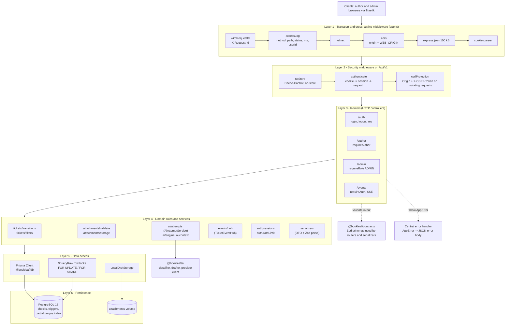
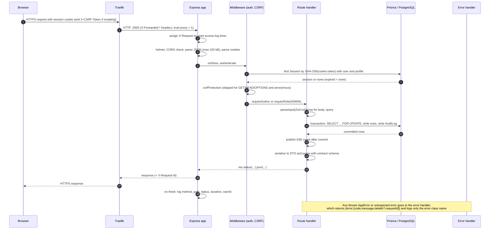

# 5. Backend Architecture

The backend is a single Node.js process (`apps/api`, Express 4.21, TypeScript, ESM) built from four npm workspaces: `@bookleaf/contracts` (Zod schemas shared with the browser), `@bookleaf/db` (Prisma schema, migrations, password hashing, seed import), `@bookleaf/ai` (AI package) and `@bookleaf/api` itself.

## 5.1 Directory structure (`apps/api/src`)

```text
apps/api/src/
├── server.ts            process entry: load config, connect Prisma, build AI engine, listen, graceful shutdown
├── app.ts               createApp(): middleware order, router mounting, 404, central error handler
├── config.ts            Zod-validated environment -> AppConfig (refuses placeholder secret / http origin in production)
├── db-check.ts          startup assertion that the database encoding is UTF-8
├── auth/
│   ├── routes.ts        POST /auth/login, POST /auth/logout, GET /auth/me
│   ├── middleware.ts    authenticate, csrfProtection, assertTrustedOrigin, requireAuth, requireRole, requireAuthor
│   ├── sessions.ts      token generation, SHA-256 hashing, create/find/revoke session, HMAC CSRF token
│   └── rateLimit.ts     FailureLimiter (in-memory sliding counter)
├── routes/
│   ├── author.ts        books, own tickets, replies, attachments (AUTHOR only)
│   ├── admin.ts         queue, detail, PATCH, replies, notes, assignment, AI, attachments (ADMIN only)
│   └── events.ts        GET /events/tickets (SSE)
├── tickets/
│   ├── transitions.ts   allowed status transition table
│   ├── filters.ts       strict query parsing + Prisma where-builder
│   ├── serializers.ts   field-by-field DTO construction validated by contract schemas
│   └── hooks.ts         optional post-commit hook interface (not wired by server.ts)
├── attachments/
│   ├── validate.ts      type allow-list, magic-byte check, filename sanitiser, Content-Disposition
│   └── storage.ts       AttachmentStorage interface + LocalDiskStorage
├── ai/
│   ├── engine.ts        AiEngine port, adapter over @bookleaf/ai, "unavailable" engine
│   ├── attempts.ts      AiAttemptService: durable attempts, single-flight, retry sweep, concurrency limit
│   └── context.ts       backend privacy allow-list for book context sent to the AI
├── events/hub.ts        TicketEventHub: in-process pub/sub with per-subscriber authorisation
├── http/                errors (AppError), validate (parseInput, asyncHandler), logger, serialize, types
└── serializers.ts       Book / AuthorProfile / current-user DTOs
```

There is no separate "controller" or "service" folder. Route modules play the controller role and contain the transaction logic inline; reusable rules are extracted into `tickets/*`, `attachments/*`, `ai/*` and `events/*`.

## 5.2 Layered architecture



**Explanation.** Requests flow downward through six layers; each layer talks only to the one below it, with two cross-cutting exceptions: the shared contract schemas (used for both input validation and output construction) and the central error handler. The AI package is reached only through `AiAttemptService` and its `AiEngine` port, so the API starts and operates even if the package or its configuration is missing (`createUnavailableEngine`).

## 5.3 Request lifecycle (browser → database → browser)



Step by step:

1. **Entry.** `app.ts` assigns an `X-Request-Id` (a client-supplied value is accepted only if it matches `^[A-Za-z0-9_-]{8,64}$`, otherwise a UUID) and starts the access-log timer. The log line is written on `finish` and contains method, **path only**, status, duration and user id; never query strings, headers or bodies.
2. **Hardening and parsing.** `helmet()` defaults, `cors({ origin: WEB_ORIGIN, credentials: true })`, `express.json({ limit: "100kb" })`, `cookie-parser`. `GET /healthz` is answered here, before authentication.
3. **Authentication** (`v1.use(authenticate)`): reads the cookie `bookleaf_session`, hashes it, looks up `Session` (+ `User` + `AuthorProfile`) and attaches `req.auth` if the session exists and has not expired. It never rejects; routes opt in.
4. **CSRF** (`v1.use(csrfProtection)`): for non-safe methods *when a session exists*, checks the `Origin` header and the `X-CSRF-Token` header (constant-time compare against `HMAC(SESSION_SECRET, "csrf:" + sessionId)`).
5. **Authorisation** inside each router: `requireAuthor` (role `AUTHOR` **and** an `AuthorProfile`), `requireRole("ADMIN")`, or `requireAuth` for `/events` and `/auth/logout|me`.
6. **Validation.** `parseInput(schema, value, label)` runs Zod and throws a `VALIDATION_ERROR` whose details carry paths and generic messages, never submitted values. Query schemas are `.strict()`: unknown keys (for example `authorId`) are rejected, so a client cannot widen the tenant scope.
7. **Business logic and persistence.** State-changing handlers open a Prisma interactive transaction, lock the ticket row with `SELECT … FOR UPDATE` (ownership is part of the author-side lock query), apply rules, write rows and one `AuditLog` row per change, commit.
8. **After commit.** SSE events are published (`events.publish`) and AI work is kicked off; neither can fail the HTTP response.
9. **Serialisation.** Responses are built field by field and parsed with the contract schema (`serializers.ts`, `tickets/serializers.ts`); Prisma rows are never spread into a response. Audit `before`/`after` JSON and `storageKey` are never serialised.
10. **Errors.** `asyncHandler` forwards rejected promises. The central handler maps `AppError` to its HTTP status, maps body-parser `entity.parse.failed` / `entity.too.large` to `VALIDATION_ERROR` (400), and turns anything else into `INTERNAL_ERROR` (500) with a fixed message.

## 5.4 Middleware summary

| Middleware | Where | Behaviour |
| --- | --- | --- |
| `withRequestId`, `accessLog` | app-wide | Correlation id; structured access log |
| `helmet()` | app-wide | Default security headers on API responses; `X-Powered-By` disabled |
| `cors` | app-wide | Allows only `WEB_ORIGIN` with credentials; methods GET, POST, PUT, PATCH, DELETE; headers `Content-Type`, `X-CSRF-Token`, `X-Request-Id`, `Last-Event-ID`; `maxAge` 600 s |
| `express.json` | app-wide | 100 kB limit |
| `express.raw` | attachment upload route only | Only for the five allowed MIME types; limit `ATTACHMENT_MAX_BYTES` (default 5 MiB) |
| `noStore` | `/api/v1` | `Cache-Control: no-store` |
| `authenticate` / `csrfProtection` | `/api/v1` | See §5.3 |
| `requireAuth`, `requireAuthor`, `requireRole` | per router / route | 401 `UNAUTHENTICATED` or 403 `FORBIDDEN` |

## 5.5 Input validation

Zod is the only validation library, and the schemas live in `packages/contracts/src/index.ts` so that the browser and the server share one definition. Highlights: ticket `subject` 3–200 and `description` 10–10 000 characters (trimmed); reply and note `body` 1–10 000; `pageSize` ≤ 100; filter enums for status, category, priority; `from`/`to` coerced dates with `from ≤ to` and inclusive end-of-day for date-only `to`. Environment variables are validated at startup by `config.ts` (names only in error messages, never values).

## 5.6 Authentication and authorisation (overview)

Server-side sessions with an opaque cookie; role checks per router; author data scoped by `AuthorProfile.id` taken from the session only. Details and sequence diagrams are in [07 – Authentication and Security](07-AUTHENTICATION-SECURITY.md).

## 5.7 Error handling

| `AppError` code | HTTP | Typical cause |
| --- | --- | --- |
| `VALIDATION_ERROR` | 400 | Bad body/query, unsupported file type, oversize body |
| `UNAUTHENTICATED` | 401 | No/invalid/expired session; wrong credentials |
| `FORBIDDEN` | 403 | Wrong role, bad Origin, missing/invalid CSRF token, assigning to someone else |
| `NOT_FOUND` | 404 | Missing **or not owned** resource, unknown route (identical response by design) |
| `CONFLICT` | 409 | Illegal status transition, closed ticket, attachment limit, nothing to unassign |
| `RATE_LIMITED` | 429 | Login, ticket-creation, reply or SSE-connection limit (with `Retry-After`) |
| `INTERNAL_ERROR` | 500 | Anything unexpected |

Body shape: `{ "error": { "code", "message", "details"?, "requestId"? } }`. Messages are authored strings; exception text is never copied to the client.

## 5.8 Logging

`createLogger()` writes one JSON object per line to stdout (`time`, `level`, `message`, scalar fields). Callers pass only vetted scalars (ids, status codes, durations, error class names, Prisma error codes). Request bodies, headers, cookies, query strings and exception messages are never logged; the release audit found no generated secret, internal-note text or ticket text in API, web, DB or Traefik logs. Compose rotates container logs with the `json-file` driver (10 MB × 3). There is no metrics endpoint, tracing or log shipping (see [14](14-NON-FUNCTIONAL-REQUIREMENTS.md)).

## 5.9 Rate limiting

All limiters are the in-memory `FailureLimiter` (a per-key counter with a reset time; per process).

| Limit | Key | Default | Source |
| --- | --- | --- | --- |
| Failed logins per account | `IP + email` | 10 per 15 min (`LOGIN_MAX_FAILURES`, `LOGIN_FAILURE_WINDOW_MINUTES`) | `auth/routes.ts` |
| Failed logins per IP | IP | 3 × the above (30) | `auth/routes.ts` |
| Ticket creation | user id | 30 per hour (`TICKET_CREATE_LIMIT_PER_HOUR`) | `routes/author.ts` |
| Author replies | user id | 60 per hour (`AUTHOR_REPLY_LIMIT_PER_HOUR`) | `routes/author.ts` |
| Open SSE streams | user id | 5 | `routes/events.ts` |
| AI refresh | ticket | 30 s cooldown on the latest attempt | `AiAttemptService` |

Admin replies, notes and status changes are not rate limited. Counters reset when the process restarts and are multiplied if more than one API replica runs; the deployment documentation therefore requires a single replica.

## 5.10 File upload processing

`POST /author/tickets/:ticketId/attachments` is a raw-body upload (`Content-Type` = the file's type, `?filename=` = display name). Order of checks: session → CSRF → ownership of the ticket (404 if missing or foreign) → ticket not `CLOSED` (409) → `express.raw` size limit → declared type in the allow-list → filename sanitised → non-empty → size ≤ limit → **magic-byte signature matches the declared type** (PDF `%PDF-`, PNG, JPEG, WebP `RIFF…WEBP`, text must be valid UTF-8 without NUL) → bytes written to disk under a random key → transaction locks the ticket row, enforces the per-ticket maximum (default 5) and inserts the row with the SHA-256. If the transaction fails, the file is deleted. Downloads set `Content-Disposition: attachment`, `X-Content-Type-Options: nosniff` and `Content-Security-Policy: default-src 'none'; sandbox`. See [08 §8.5](08-TICKET-LIFECYCLE.md) for the lifecycle diagram.

## 5.11 Ticket state transitions

Defined in one table (`tickets/transitions.ts`); admin-only (`PATCH /admin/tickets/:id`). The source comment states this table is the backend's own documented assumption because the original architecture documents named the statuses but defined no transitions.

| From \ To | `OPEN` | `IN_PROGRESS` | `RESOLVED` | `CLOSED` |
| --- | :---: | :---: | :---: | :---: |
| `OPEN` | – | ✔ | ✔ | ✔ |
| `IN_PROGRESS` | ✔ | – | ✔ | ✔ |
| `RESOLVED` | ✔ | ✔ | – | ✔ |
| `CLOSED` | ✘ | ✘ | ✘ | – |

`CLOSED` is terminal: a closed ticket rejects status changes, category/priority changes, replies (author and admin), attachments, assignment changes and AI analysis with `409 CONFLICT`. Notes: an unchanged value is a no-op (HTTP 200, no audit row); author and admin replies do **not** change status; an admin may still add an internal note to a closed ticket (the route has no status check).

## 5.12 AI processing

`POST /author/tickets` writes a `PENDING` `AiAnalysis` row in the same transaction as the ticket and, after commit, calls `ai.kick(attemptId)`; the attempt runs in the background (max 2 concurrent provider runs per process). A recovery timer (every 60 s) abandons stale `PENDING` rows and retries transient failures at most twice. Full detail: [09](09-AI-ARCHITECTURE.md).

## 5.13 Audit trail

Every admin state change and every reply/note writes an `AuditLog` row in the **same transaction** as the change, with actor, action, `entityType = "Ticket"`, `entityId`, before/after values (enum names and ids only), and the request id. The table is append-only by trigger. Admins see the 100 most recent ticket audit events on the ticket detail response (`auditEvents`, without the raw before/after). Events not audited: ticket creation, attachment upload, login/logout, AI completion (only the *request* for an analysis is audited).

## 5.14 Startup and shutdown

Startup (`server.ts`): load `apps/api/.env` if present (development convenience) → `loadConfig()` → `prisma.$connect()` → `assertUtf8Database()` → `loadPackageEngine()` (falls back to the unavailable engine) → `ai.start()` → `listen(PORT)`. Shutdown on `SIGTERM`/`SIGINT`: close all SSE streams, stop accepting connections, stop the AI service (waits for in-flight runs), disconnect Prisma; a 10 s timer forces exit. The graceful path is code-reviewed only (`KNOWN_LIMITATIONS.md`). Uncaught exceptions are logged by class name and terminate the process; the Compose restart policy `unless-stopped` restarts it.
