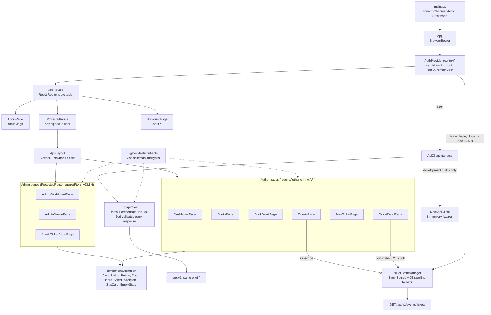
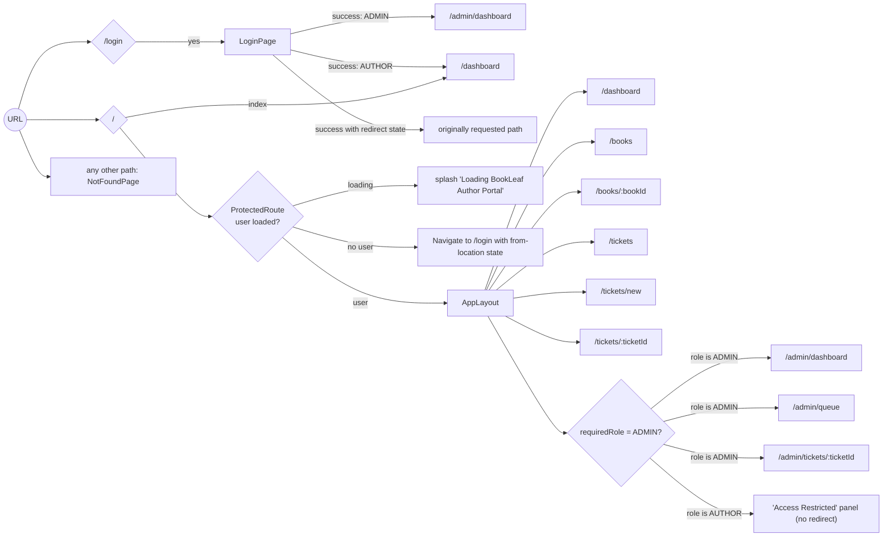
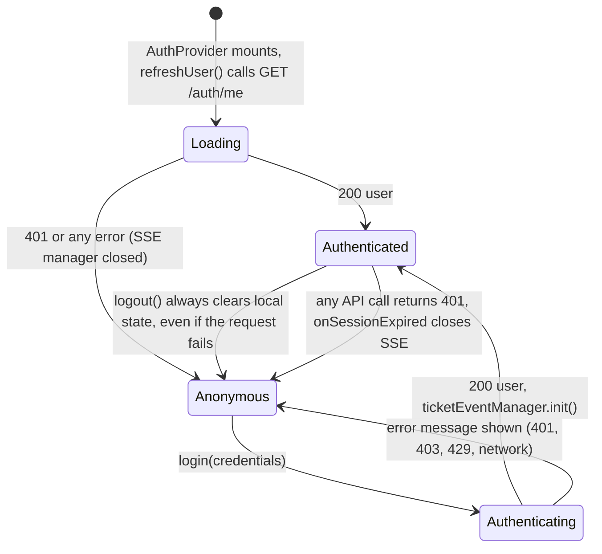
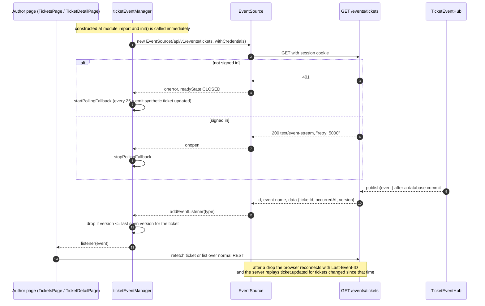
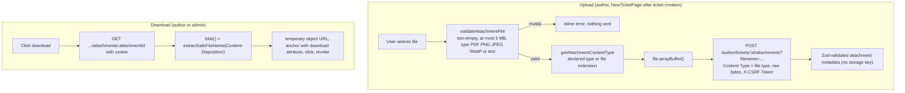

# 6. Frontend Architecture

Single-page application in `apps/web`: React 18.3, TypeScript, Vite 6, React Router 7 (`react-router-dom ^7.18.4`), Tailwind CSS 3.4, `lucide-react` icons, Zod via `@bookleaf/contracts`. There is **no** Redux/Zustand/React Query: state is local `useState` plus one React context. Unit tests use Vitest + jsdom; end-to-end tests use Playwright (Chromium).

## 6.1 Source layout

```text
apps/web/src/
├── main.tsx                  ReactDOM root (StrictMode)
├── App.tsx                   BrowserRouter > AuthProvider > AppRoutes
├── router/
│   ├── AppRoutes.tsx         route table
│   └── ProtectedRoute.tsx    auth + optional role gate
├── context/AuthContext.tsx   user, isLoading, login, logout, refreshUser, client
├── api/
│   ├── client.ts             ApiClient interface, ApiClientError, DownloadResult
│   ├── http.ts               HttpApiClient (fetch, CSRF header, Zod response validation, 401 notification)
│   ├── mock.ts               MockApiClient (in-memory fixtures; development only)
│   ├── index.ts              chooses the client (mock never used in production builds)
│   ├── events.ts             TicketEventManager: EventSource + polling fallback + de-duplication
│   └── attachments.ts        client-side type/size checks, filename sanitiser, Content-Disposition parser
├── components/
│   ├── layout/               AppLayout (sidebar + navbar + <Outlet/>), Sidebar, Navbar
│   └── common/               Alert, Badge, Button, Card, EmptyState, Input, Select, Skeleton, StatCard
├── pages/
│   ├── auth/LoginPage.tsx
│   ├── author/               DashboardPage, BooksPage, BookDetailPage, TicketsPage, NewTicketPage, TicketDetailPage
│   ├── admin/                AdminDashboardPage, AdminQueuePage, AdminTicketDetailPage
│   └── NotFoundPage.tsx
└── test/                     Vitest suites (admin, api-client, attachments, auth, author-replies-sse, books, tickets)
```

There are no custom hooks files: the only hook is `useAuth()` exported from `AuthContext.tsx`. Shared utilities live in `api/attachments.ts` and `api/events.ts`.

## 6.2 Component architecture



**Explanation.** `App` wraps the whole tree in the router and the single `AuthProvider`. Every page obtains the API client from `useAuth()`, so tests and development can swap the implementation. Only author pages subscribe to the live-event manager; admin pages load on navigation and after their own actions (verified: no `ticketEventManager` usage under `pages/admin`). Server-side authorisation is independent of this tree: hiding a link or a route in the UI is never the control.

## 6.3 Routing



The table of routes (`router/AppRoutes.tsx`):

| Path | Guard | Page |
| --- | --- | --- |
| `/login` | public | `LoginPage` |
| `/` | signed in | redirects to `/dashboard` |
| `/dashboard`, `/books`, `/books/:bookId`, `/tickets`, `/tickets/new`, `/tickets/:ticketId` | signed in (any role) | author pages |
| `/admin/dashboard`, `/admin/queue`, `/admin/tickets/:ticketId` | signed in **and** `role === "ADMIN"` | admin pages |
| `*` | – | `NotFoundPage` |

Note that the author routes are guarded only by "signed in", not by role. The data they request comes from `/author/*` endpoints that return **403** for an admin account.

## 6.4 Navigation structure

| Role | Sidebar entries (`components/layout/Sidebar.tsx`) |
| --- | --- |
| Author | Author Dashboard (`/dashboard`), My Books (`/books`), Support Tickets (`/tickets`), New Ticket (`/tickets/new`) |
| Admin | Admin Overview (`/admin/dashboard`), Ticket Queue (`/admin/queue`), Browse Titles (`/books`) |

Page hierarchy (what each page reads and writes):

```text
AppLayout
├── Author
│   ├── DashboardPage          GET books (pageSize 50), GET tickets (pageSize 25)
│   ├── BooksPage              GET /author/books?page&pageSize
│   │   └── BookDetailPage     GET /author/books/:id
│   ├── TicketsPage            GET /author/tickets (filters, pagination); SSE refresh
│   ├── NewTicketPage          GET books (100); POST /author/tickets; then POST attachment per file
│   └── TicketDetailPage       GET ticket + attachments; POST message; attachment download; SSE + 25 s poll
└── Admin
    ├── AdminDashboardPage     GET /admin/tickets (pageSize 50) for counters
    ├── AdminQueuePage         GET /admin/tickets (filters, pagination)
    └── AdminTicketDetailPage  GET detail + attachments; PATCH ticket; POST reply / note;
                               PUT assignment; POST ai-analysis; attachment download
```

Observation (not browser-tested here): the admin sidebar entry "Browse Titles" and the "Associated Book" link in `AdminTicketDetailPage` point at `/books…`, which calls `GET /author/books…`. The API restricts that route to `AUTHOR` users with an author profile, so these two links are expected to produce a permission error for an admin. This is derived from the source (`requireAuthor`), not from running the UI.

## 6.5 Authentication state flow



State lives in `AuthContext`: `user` (`CurrentUser | null`), `isLoading`, `error`. There is no token in JavaScript: the session cookie is `HttpOnly`. Session validity is re-checked by `GET /auth/me` on every full page load (`refreshUser`); there is no periodic refresh, and the session's lifetime is fixed on the server (default 7 days). A 401 from any API call triggers the registered `onSessionExpired` handlers, which close the live-event connection. The route guard then redirects to `/login` the next time `user` is `null`; the context's `user` is only cleared by `refreshUser` or `logout`.

## 6.6 API client communication

`HttpApiClient` (`api/http.ts`) is the single network layer:

* Base URL `VITE_API_BASE_URL` if set, otherwise the same-origin relative path `/api/v1` (the production image leaves it unset).
* Every request uses `credentials: "include"`.
* For `POST/PUT/PATCH/DELETE` it reads the CSRF value from the `XSRF-TOKEN` cookie (also accepts `csrfToken`, `_csrf`, or a `<meta name="csrf-token">`) and sends it as `X-CSRF-Token`.
* Responses are parsed with the matching contract schema; a mismatch raises `ApiClientError("CONTRACT_VALIDATION_ERROR")`.
* Non-2xx bodies are parsed with `apiErrorSchema` into `ApiClientError(code, message, status, details, requestId)`; a network failure becomes `NETWORK_ERROR` (status 0); `204` returns `undefined`.
* `MockApiClient` is selected only when `import.meta.env.PROD` is false and `VITE_USE_MOCKS !== "false"`; production builds always use the HTTP client and `toggleMockMode` is refused.

## 6.7 State management and error handling

* **State:** component-local `useState`/`useCallback`/`useEffect`; one global context (`AuthContext`); one module-level singleton (`ticketEventManager`) holding the `EventSource`, listeners and the last seen version per ticket.
* **Errors:** pages catch `ApiClientError`, show an `Alert` or inline message; a few admin actions use `window.alert` for failures. Failed attachment-list loads degrade to an empty list. There is no global React error boundary in the source.
* **Loading:** `Skeleton` placeholders and the `ProtectedRoute` splash screen.

## 6.8 Real-time update handling



Details verified in `api/events.ts` and the pages:

* The payload carries only `ticketId`, `occurredAt`, `version`; the page refetches the data over REST, so authorisation is re-applied on every read.
* De-duplication uses `(ticketId, version)`; `TicketDetailPage` additionally compares a snapshot of `updatedAt`, `status`, message count and attachment count before updating the UI.
* `TicketDetailPage` also polls every 25 s regardless of SSE; the manager's fallback polling emits a synthetic `ticket.updated` every 25 s (`ticketId: ""`), which makes subscribed pages refetch.
* Login calls `ticketEventManager.init()`, logout and 401 call `close()`. The release audit measured a reply appearing in 0.5 s over SSE and in 25.0 s with `EventSource` removed.
* Admin pages do not subscribe; the admin-only events (`ticket.analysis.updated`, internal-note `ticket.updated`) are therefore delivered to admin streams but not used by the current admin UI.

## 6.9 File upload and download flow



The client-side checks are a convenience; the server repeats and strengthens every one (magic-byte verification, per-ticket limit, ownership, `CLOSED` check). Files are never rendered inline: the server sends `Content-Disposition: attachment` and the SPA saves the blob through an anchor with the `download` attribute.

## 6.10 Security-relevant frontend facts

* The nginx image sets `Content-Security-Policy: default-src 'self'; script-src 'self'; style-src 'self' 'unsafe-inline' https://fonts.googleapis.com; font-src 'self' https://fonts.gstatic.com; img-src 'self' data:; connect-src 'self'; object-src 'none'; base-uri 'self'; form-action 'self'; frame-ancestors 'none'`. Google Fonts is the only third-party origin.
* User-supplied text is rendered through React (escaped); the release audit verified a stored-XSS payload renders inert.
* The development-only "Workspace Switcher" in `Sidebar.tsx` embeds demo credentials for mock/dev use, guarded by `!import.meta.env.PROD`, so it does not render in production builds. (Commit `99a221e`, "remove demo credentials from production login", addressed the login page; whether the strings are also tree-shaken from the production bundle was not inspected for this document.)
