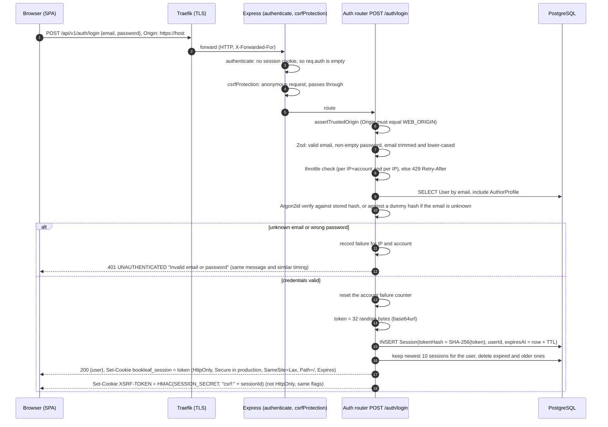
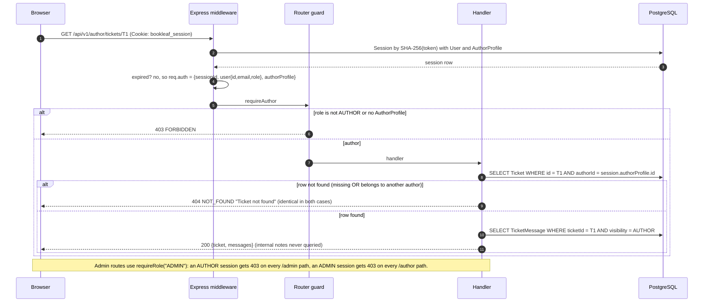
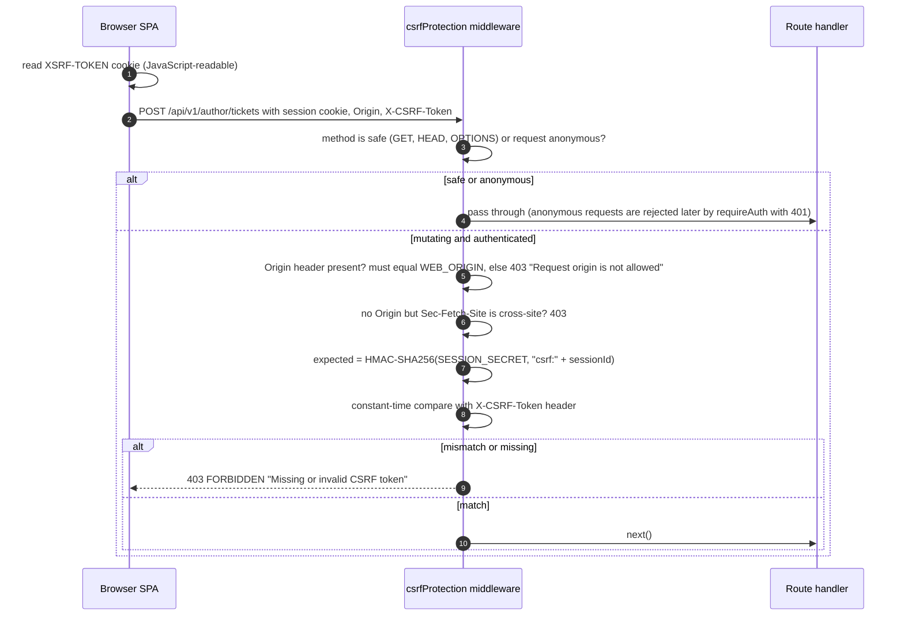
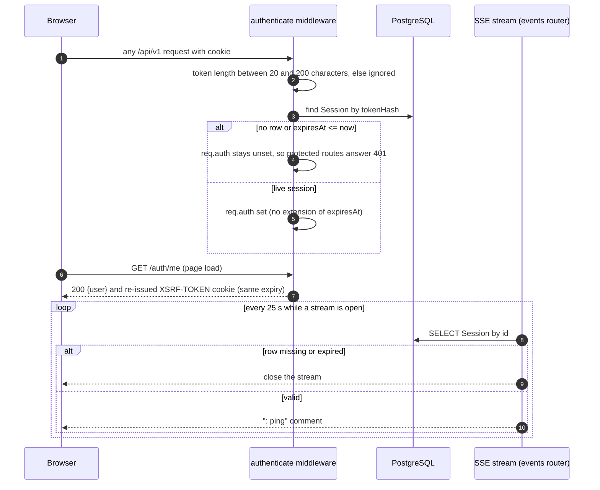
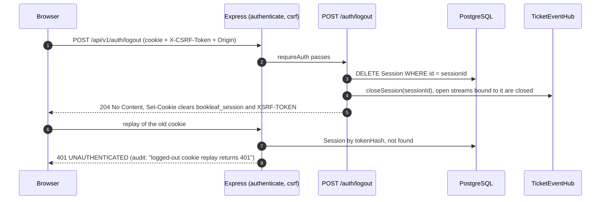
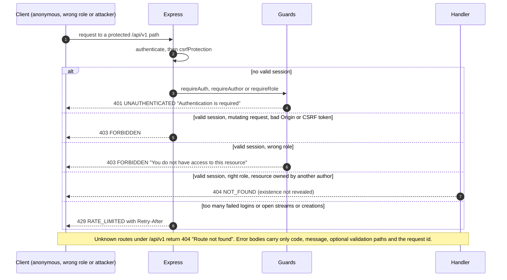

# 7. Authentication and Security Architecture

**Model implemented: server-side sessions with an opaque random cookie, plus a session-bound CSRF token.** There is no JWT, no refresh token, no OAuth/OIDC and no API key authentication anywhere in the source. Passwords are verified with Argon2id; the session is a row in PostgreSQL.

## 7.1 Login and session creation

Facts, all from `auth/routes.ts`, `auth/sessions.ts`, `auth/middleware.ts`:

* **Password hashing:** Argon2id via the `argon2` package, `memoryCost 19 456` KiB, `timeCost 2`, `parallelism 1` (OWASP minimum). Verification reads parameters from the stored hash. A malformed hash verifies as `false`, never throws.
* **Timing equalisation:** when the e-mail does not exist, the password is still verified against a lazily created dummy hash, so response time does not reveal account existence. The error message is identical for both failure cases.
* **Session storage:** table `Session`; only the SHA-256 of the cookie token is stored, so a database leak does not yield usable sessions. Lifetime `SESSION_TTL_HOURS` (default 168, max 2 160); fixed, not sliding. Opportunistic clean-up on each login for that user (expired rows dropped, at most 10 live sessions kept; the oldest are revoked and their event streams close at the next heartbeat). Users who never log in again keep their expired rows.
* **Cookies:** names `bookleaf_session` (HttpOnly) and `XSRF-TOKEN` (readable by JavaScript by design so the SPA can echo it). Both: `Secure` when `NODE_ENV=production`, `SameSite=Lax`, `Path=/`, `Expires` = session expiry. The release audit confirmed these flags on the live HTTPS site.
* **Login throttling:** 10 failures per (IP, account) and 30 per IP in 15 minutes, in memory (single instance), answered with 429 and `Retry-After` (audit: observed `Retry-After: 900`).

## 7.2 Authenticated API request and role-based authorisation

Authorisation rules as implemented:

| Rule | Mechanism |
| --- | --- |
| Author sees only own books, tickets, messages, attachments | `authorId = req.auth.authorProfile.id` is part of every author query; the id comes **only** from the session; list filters are `.strict()` so `authorId` in a query string is rejected; the scope is applied last (`{ ...filterWhere(filter), authorId }`) |
| Foreign resources are indistinguishable from missing ones | 404 with the same message for both (tickets, books, attachments) |
| Creating a ticket against another author's book | Checked inside the creating transaction with `SELECT … FOR SHARE` on the book row, answered `404 Book not found`; the `Ticket_book_author` trigger is a second line of defence |
| Author cannot create internal notes, admin-only messages or AI drafts | The reply schema has only `body`; the route always writes `visibility = AUTHOR`; unknown fields are ignored |
| Admin-only data (internal notes, AI analysis, audit events, other authors' profiles) | Only on `/admin/*` routes (`requireRole("ADMIN")`); author serialisers throw if handed an `ADMIN`-visibility message |
| Admins can assign only to themselves | `PUT …/assignment` returns 403 if `assigneeId` is another user; the database trigger additionally requires the assignee to be an `ADMIN` |
| Live events | `TicketEventHub.canReceive`: admins receive everything; an author receives only `audience: "all"` events for their own `authorProfileId`; AI and internal-note events are `audience: "admin"` |

## 7.3 CSRF validation and origin checking

* The CSRF token is **stateless and bound to the session**: `HMAC(SESSION_SECRET, "csrf:" + sessionId)`. It dies with the session and cannot be derived without the server secret. It is re-issued by `GET /auth/me` so a client that lost the cookie can recover.
* This is a double-submit pattern plus an Origin check. `SameSite=Lax` cookies add a third layer. CORS allows only `WEB_ORIGIN` (credentials on); the audit confirmed a foreign origin gets no CORS allow header.
* **Login CSRF:** there is no session yet, so `POST /auth/login` is protected by `assertTrustedOrigin` alone. Edge case (from reading the middleware order): `csrfProtection` runs *before* the auth router, so a login request that still carries a valid old session cookie must also carry a valid CSRF token or it is rejected with 403.
* **Known gap (documented):** a request with **no** `Origin` header is accepted (non-browser clients send none); for authenticated mutating calls the CSRF token is still required, but the login endpoint then relies on the absence of cross-site context only.

## 7.4 Session validation, refresh and revocation

There is **no refresh flow**. Validity is checked on every request by a database lookup; the session expires at its fixed `expiresAt`.

## 7.5 Logout and session revocation

Revocation paths that exist: logout (this diagram), expiry, and the 10-session cap at login. Paths that do **not** exist: "log out everywhere", admin-initiated revocation, password change or reset (there is no endpoint for either), session revocation on role change.

## 7.6 Unauthorised access rejection

## 7.7 Security controls inventory

| Control | Implemented? | Evidence / note |
| --- | --- | --- |
| Password hashing (Argon2id) | Implemented, tested | `@bookleaf/db/password.ts`; seed hashes with the same function |
| Server-side sessions, hashed token storage | Implemented, tested | `auth/sessions.ts`; E2E checks cookie flags, replay after logout |
| HttpOnly + Secure + SameSite=Lax cookies | Implemented, tested, deployed | E2E `03-production-proxy.spec.ts`; audit on live site |
| CSRF token + Origin validation | Implemented, tested, deployed | E2E `02-boundaries.spec.ts`; audit |
| Role-based authorisation | Implemented, tested, deployed | |
| Cross-author isolation (REST, attachments, SSE) | Implemented, tested, deployed | E2E boundaries; audit |
| Login throttling / per-user write limits | Implemented, tested | In memory, per process |
| Input validation (Zod, strict queries, size limits) | Implemented, tested | |
| Upload restrictions | Implemented, tested, deployed | allow-list of 5 types, magic-byte check, 5 MiB, 5 per ticket, random storage keys, forced download, `nosniff`, `CSP: default-src 'none'; sandbox`; audit rejected HTML-as-PNG, SVG, NUL-byte text, oversize |
| Attachment authorisation | Implemented, tested | Author: attachment must belong to the ticket **and** the ticket to the author; admin: any ticket |
| Secure headers (API) | Implemented, deployed | `helmet()` defaults, `X-Powered-By` removed; `Cache-Control: no-store` on `/api/v1` |
| Secure headers (web) | Implemented, deployed | nginx: CSP (`default-src 'self'`, `frame-ancestors 'none'`), `X-Frame-Options: DENY`, `nosniff`, `Referrer-Policy`, `Permissions-Policy`; HSTS added by Traefik |
| TLS termination | Deployed | Traefik with Let's Encrypt (HTTP-01); the audit recorded issuer and expiry; **renewal was not observed** |
| Prompt-injection and PII defences for AI | Implemented, tested | [09](09-AI-ARCHITECTURE.md) |
| Audit trail, append-only | Implemented, tested | DB trigger |
| Log hygiene (no bodies, headers, cookies, secrets) | Implemented, audited | audit §7 |
| Rate limiting across replicas, MFA, password reset, account lockout notices, antivirus scanning, e-mail verification | **Not implemented** | See [17](17-KNOWN-LIMITATIONS.md) |

## 7.8 Secrets management

* All secrets are environment variables: `SESSION_SECRET` (≥ 32 characters; the API refuses placeholder-looking values in production), `POSTGRES_PASSWORD`, `OPENROUTER_API_KEY`, and the seed passwords. The API's `config.ts` error messages name variables, never values.
* Compose uses `${VAR:?message}` so a missing required value stops `docker compose up`. On the VPS the `.env` file is mode 600 and not in the repository; `.env.example` ships empty values. The release audit scanned tracked files for secret patterns (only a deliberately fake key inside a prompt-injection test was found).
* `OPENROUTER_API_KEY` is wrapped in a `Secret` class in `@bookleaf/ai` whose `toString`, `toJSON` and inspect output are `[REDACTED]`. The provider client sets `redirect: "error"` so the bearer token can only go to the configured host.
* The confidential source dataset is git-ignored and excluded by `.dockerignore`; the seed job reads only `data/synthetic_seed.json`.
* No secret manager (Vault, cloud KMS) is used; rotation is manual (edit `.env`, recreate containers).
