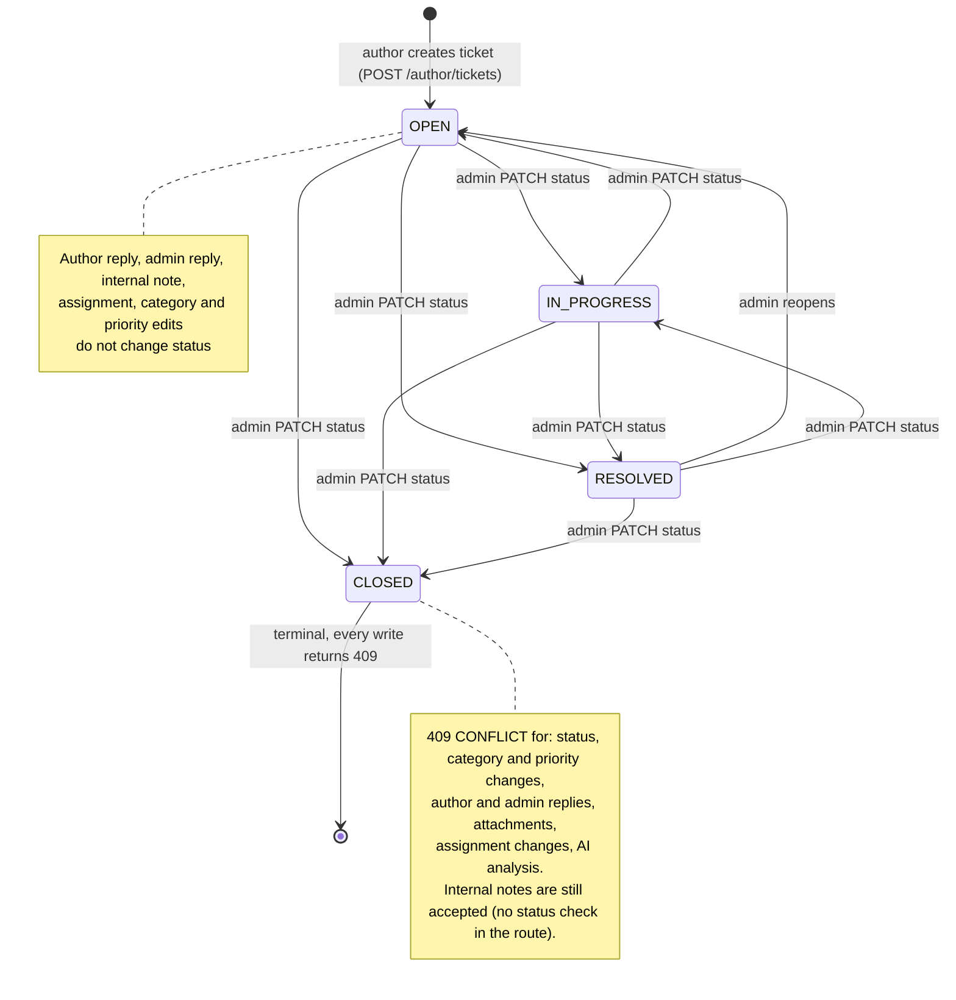
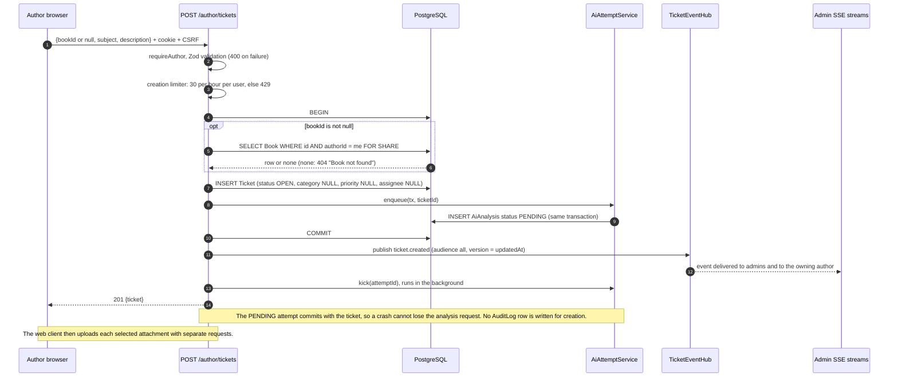
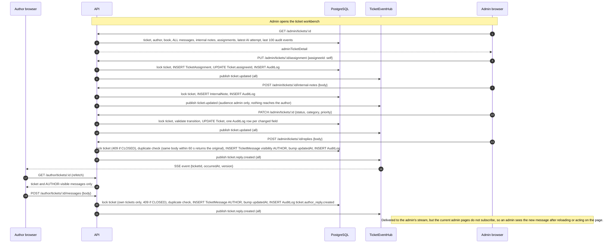
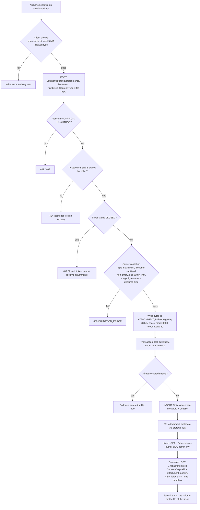

# 8. Ticket Management Architecture

## 8.1 Ticket attributes and who controls them

| Attribute | Values | Set by | Notes |
| --- | --- | --- | --- |
| `status` | `OPEN` (initial), `IN_PROGRESS`, `RESOLVED`, `CLOSED` | Admin (`PATCH /admin/tickets/:id`) | Transition table in §8.2 |
| `category` | `ROYALTY_PAYMENTS`, `ISBN_METADATA`, `PRINTING_QUALITY`, `DISTRIBUTION_AVAILABILITY`, `BOOK_STATUS_PRODUCTION`, `GENERAL_INQUIRY` | Admin only; initially `NULL` | The AI *suggests* a category in `AiAnalysis`; it is never copied to the ticket automatically |
| `priority` | `CRITICAL`, `HIGH`, `MEDIUM`, `LOW` | Admin only; initially `NULL` | Same: AI suggestion lives in `AiAnalysis` |
| `assigneeId` | an `ADMIN` user or `NULL` | Admin, **to self only** (`PUT …/assignment`) | Every change adds a `TicketAssignment` history row |
| `bookId` | one of the author's books or `NULL` | Author at creation | Cannot be changed afterwards (no route) |
| `subject`, `description` | 3–200 / 10–10 000 characters | Author at creation | Immutable afterwards |

Visibility: an author sees their own ticket fields (including `assigneeId`, an opaque id, a documented low-risk leak), the author-visible conversation and attachment metadata. Internal notes, AI analysis, assignment history and audit events are admin-only.

## 8.2 Ticket state diagram

The nine permitted edges are exactly those in `tickets/transitions.ts` (`OPEN`→{`IN_PROGRESS`,`RESOLVED`,`CLOSED`}, `IN_PROGRESS`→{`OPEN`,`RESOLVED`,`CLOSED`}, `RESOLVED`→{`OPEN`,`IN_PROGRESS`,`CLOSED`}). No code moves a ticket to `RESOLVED` or `CLOSED` automatically, and an author reply does **not** reopen a resolved ticket. A request that sets the same status again is a no-op (HTTP 200, no audit row). The release audit verified "reopen/reply/attachment on CLOSED all 409" on staging.

## 8.3 Ticket creation

If the AI engine is unavailable or unconfigured the ticket is still created and the attempt ends as `FAILED` (`AI_NOT_CONFIGURED`); ticket handling never depends on AI.

## 8.4 Author–admin communication

Rules worth stating:

* **A reply is a message only when a human sends it.** The AI draft is data on the admin screen; "Use AI draft" copies text into the admin's reply box (`handleUseAiDraft`), and only `POST …/replies` creates a `TicketMessage`.
* **Idempotent retry.** An identical body from the same sender on the same ticket within 60 seconds returns the original message (HTTP 201) instead of creating a second one.
* **Concurrency.** Writers lock the ticket row with `SELECT … FOR UPDATE`, so replies, status changes, assignment and AI requests on one ticket are serialised.
* **`updatedAt` is the change marker.** Replies explicitly bump it; it becomes the SSE event `version`, the catch-up cursor after reconnect and the polling comparison value. Internal notes are announced with a *new* timestamp but only to admins, so a note never looks like a ticket change to the author.
* **Resolution.** An admin sets `RESOLVED` (reopenable) or `CLOSED` (terminal). There is no automatic resolution, no author "close ticket" action and no e-mail notification (the UI text that mentions e-mail is aspirational; `KNOWN_LIMITATIONS.md`).

## 8.5 Attachment lifecycle

Lifecycle facts: only authors upload (there is no admin upload route); both roles can list and download; there is **no delete or replace route**, so files persist as long as the ticket row. If a ticket row were ever deleted by an operator the `Cascade` rule removes the metadata but not the file on disk (no cleanup job exists). Backups must include both the database and the attachments volume (`infra/scripts/backup.sh` does). Attachment content is **not** read by the AI in the current implementation (the AI input has no attachment field).

## 8.6 Audit events by action

| User action | Audit `action` | Written in the same transaction as |
| --- | --- | --- |
| Admin changes status / category / priority | `ticket.status.updated`, `ticket.category.updated`, `ticket.priority.updated` (one row per changed field) | the ticket update |
| Admin assigns / unassigns | `ticket.assignment.updated` | assignment row + ticket update |
| Admin replies | `ticket.reply.created` | the message |
| Author replies | `ticket.author_reply.created` | the message |
| Admin adds internal note | `ticket.internal_note.created` | the note |
| Admin requests AI analysis (new attempt created) | `ticket.ai_analysis.requested` | the new `PENDING` attempt |
| Ticket creation, attachment upload, login, logout, AI completion | *none* | – |
