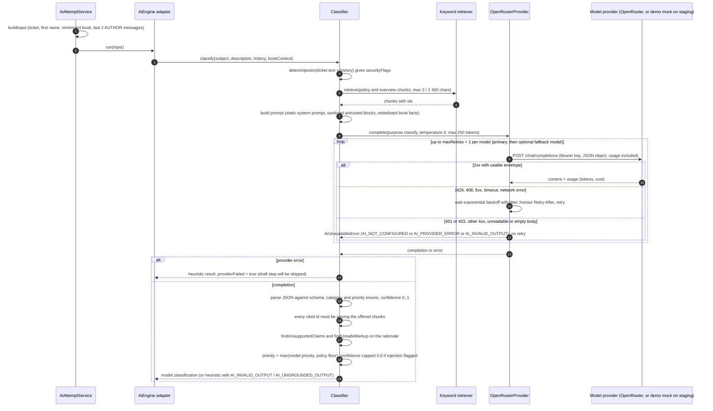
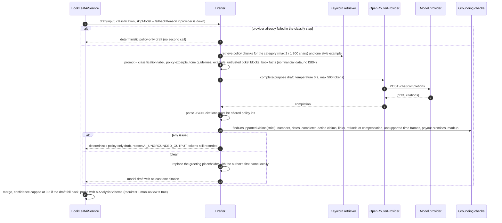
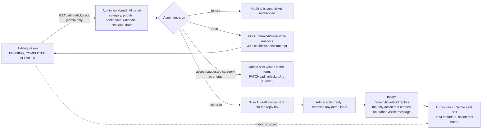
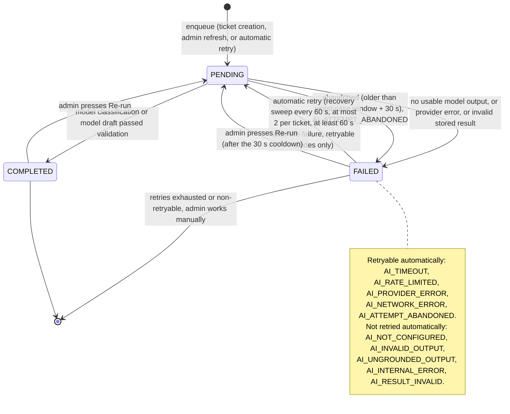
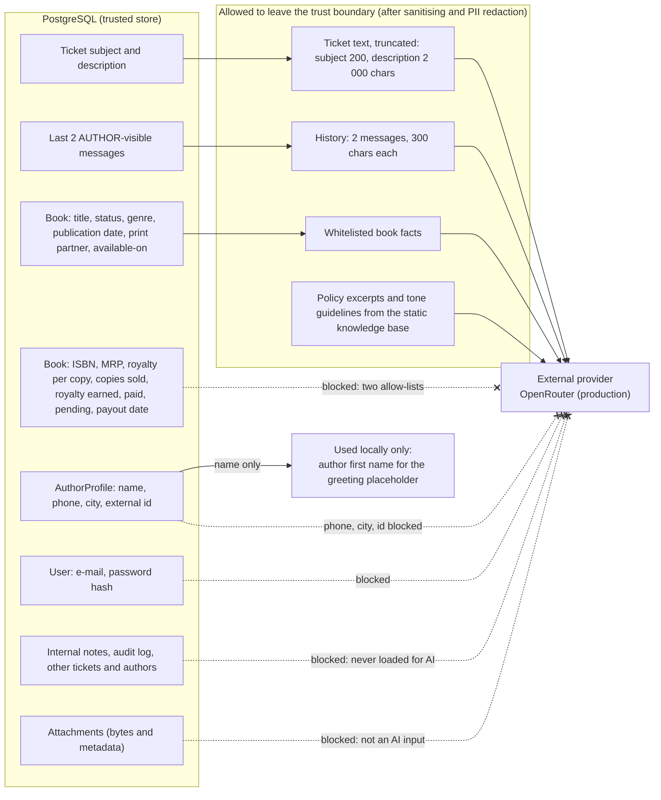

# 9. AI System Architecture

> **Read this first.** The AI feature is **advisory**: it classifies a ticket and drafts a reply for an admin to review. It cannot send a message, change a ticket's status, category, priority or assignment, or reach an author.
>
> **The staging deployment uses a deterministic mock provider (`infra/mock-ai`). It does not perform language-model inference.** Its outputs are canned, keyword-matched demonstration text labelled `[DEMO MOCK …]` / `[DEMO DRAFT …]`. Successful staging runs and mock-based tests demonstrate that the pipeline, validation, persistence and review UI work; they are **not** evidence of real-model quality, latency or cost. The code path to the real provider (default free model, zero-spend guard) exists and was exercised once with a real key on 2026-10-16 with partial results (see `docs/release/AI_REAL_PROVIDER.md`); the staging site itself has never run it.

## 9.1 Components

| Component | Location | Role |
| --- | --- | --- |
| `AiAttemptService` | `apps/api/src/ai/attempts.ts` | Owns durable attempts in `AiAnalysis`: creates `PENDING` rows, single-flight, background execution (concurrency 2), result persistence, abandonment, bounded automatic retry, `ticket.analysis.updated` event. Never classifies or drafts |
| `AiEngine` port + adapter | `apps/api/src/ai/engine.ts` | Adapts the `@bookleaf/ai` module to the API; loads it lazily; falls back to `createUnavailableEngine()` (records `AI_NOT_CONFIGURED`) if the package or its config is missing |
| Backend privacy allow-list | `apps/api/src/ai/context.ts` | First minimisation of book context |
| `BookLeafAiService` | `packages/ai/src/service.ts` | classify → draft → merge into the shared `aiAnalysisSchema`; `requiresHumanReview` is the literal `true` |
| Classifier | `packages/ai/src/classifier/*` | Prompt, model call, schema parse, citation check, grounding check, heuristic fallback, priority floors |
| Drafter | `packages/ai/src/drafting/*` | Prompt, model call, schema parse, citation and grounding checks, deterministic policy-only fallback |
| Knowledge base + retriever | `packages/ai/src/knowledge/*` | Static knowledge chunks (version `bookleaf-assignment-kb-v1`: 1 company overview, 5 category policies, 1 tone guideline, plus per-category examples); deterministic keyword retriever with a category boost; no embeddings, no vector store |
| Safety | `packages/ai/src/safety.ts` | `sanitizeUntrusted` (NFKC, strip invisible/control characters, defuse `<` `>`, collapse whitespace, truncate), `redactPii` (e-mails, long digit runs), `detectInjection` (7 heuristic labels), random per-call `<untrusted-NONCE>` boundary |
| Grounding | `packages/ai/src/grounding*.ts` | Every number and date in generated text must appear in the supplied sources; no "already done" claims; strict mode also rejects links, refund/compensation commitments, unsupported time frames and payout promises |
| OpenRouter client | `packages/ai/src/provider/openrouter.ts` | `POST {baseUrl}/chat/completions` with `response_format: json_object`, timeout, bounded retries with jittered backoff, optional fallback model, `redirect: "error"` |
| Persistence mapping | `packages/ai/src/persistence.ts` | Pure functions: pending/failed rows, `decideAttempt`, `serializeAttempt`, `retryAdviceFor` |
| Staging mock | `infra/mock-ai/server.mjs` | Demonstration stand-in described in §9.9 |

## 9.2 AI processing flowchart

```mermaid
%% file: ai-workflow.mmd
flowchart TB
    START["Author creates ticket<br/>or admin presses 'Re-run AI'"] --> ENQ["enqueue inside the ticket transaction<br/>(lock ticket row FOR UPDATE)"]
    ENQ --> SF{"latest attempt state?"}
    SF -- "PENDING and not abandoned" --> JOIN["return it unchanged (single-flight)"]
    SF -- "PENDING but older than the worst-case window" --> AB["close as FAILED AI_ATTEMPT_ABANDONED"] --> NEW
    SF -- "terminal and younger than 30 s (admin refresh only)" --> JOIN
    SF -- "otherwise" --> NEW["INSERT AiAnalysis status PENDING<br/>(partial unique index: one PENDING per ticket)"]
    NEW --> COMMIT["COMMIT, then kick(attemptId)<br/>background slot, max 2 concurrent runs"]
    COMMIT --> IN["Build input<br/>ticket subject and description, author first name for greeting only,<br/>minimised book facts, last 2 AUTHOR-visible messages"]
    IN --> SAN["Sanitise untrusted text: strip invisible chars, defuse angle brackets,<br/>redact e-mails and long numbers, truncate, wrap in random untrusted boundary"]
    SAN --> DET["detectInjection: security flags (signal only)"]
    DET --> RET["Keyword retrieval of policy chunks (max 3, 2 400 chars)"]
    RET --> CL["Provider call 1: classify<br/>temperature 0, JSON object"]
    CL --> CLV{"valid JSON, known category and priority,<br/>citations only from offered chunks,<br/>rationale grounded?"}
    CLV -- "provider failed" --> HEU["heuristic keyword classification<br/>confidence at most 0.3, skip draft call"]
    CLV -- "invalid or ungrounded" --> HEU2["heuristic classification (billed tokens kept)"]
    CLV -- "yes" --> FLOOR["apply policy priority floor (only raises)<br/>cap confidence at 0.6 if injection flagged"]
    HEU --> DR
    HEU2 --> DR
    FLOOR --> DR["Provider call 2: draft<br/>temperature 0.2, JSON object"]
    DR --> DRV{"valid JSON, citations offered,<br/>numbers and dates grounded,<br/>no completed-action claims, links, commitments,<br/>unsupported timelines, payout promises?"}
    DRV -- "no or provider down" --> FB["deterministic policy-only draft<br/>confidence capped at 0.5"]
    DRV -- "yes" --> OKD["model draft, greeting name substituted locally"]
    FB --> DEC
    OKD --> DEC{"decideAttempt"}
    DEC -- "model classification or model draft used" --> COMP["COMPLETED (MODEL or PARTIAL_FALLBACK)"]
    DEC -- "neither used" --> FAIL["FAILED with errorCode"]
    COMP --> SAN2["sanitiseRow: re-validate against the shared contract schema,<br/>invalid becomes FAILED AI_RESULT_INVALID"]
    FAIL --> SAN2
    SAN2 --> WR["UPDATE ... WHERE id AND status = PENDING<br/>(only one writer wins), DB state check enforces consistency"]
    WR --> EVT["publish ticket.analysis.updated (admin audience only)"]
    EVT --> REV["Admin reviews on the ticket workbench"]
```

**Explanation.** Each branch ends in a stored, well-formed row; the pipeline never throws to the caller. Provider and output problems degrade to heuristics or a template instead of blocking ticket handling. The "worst-case window" is `2 × models × ((retries+1) × timeout + backoff) + 30 s`; with the defaults (15 s timeout, 2 retries, 0.5 s/4 s backoff, no fallback model) that is about 123 s (computed from `worstCaseAnalysisMs`, not measured).

## 9.3 Classification sequence

## 9.4 Drafting sequence

## 9.5 Human-in-the-loop review

Guarantees that make this human-in-the-loop (all verified in code): the AI service has no send capability; `POST …/ai-analysis` returns an attempt and "never sends anything"; there is no route that turns a draft into a `TicketMessage`; author routes never load `AiAnalysis`; the author-facing serialiser rejects admin-visibility messages; the AI-related SSE events are admin-audience only. The browser E2E test "AI draft review with the mocked provider, never auto-sent" and the release audit ("author message count unchanged after analysis") cover this behaviour.

## 9.6 Failure and retry state machine

| Error code | Meaning | Auto retry |
| --- | --- | --- |
| `AI_NOT_CONFIGURED` | No/invalid key, bad base URL, or provider answered 401/403 | No (retry advice "after-config") |
| `AI_TIMEOUT`, `AI_NETWORK_ERROR` | Provider unreachable or too slow | Yes |
| `AI_RATE_LIMITED` | HTTP 429 | Yes |
| `AI_PROVIDER_ERROR` | 5xx/408 or other rejection | Yes |
| `AI_INVALID_OUTPUT` | Not valid JSON / wrong shape / empty | No (admin may refresh) |
| `AI_UNGROUNDED_OUTPUT` | Citation not offered, or a number, date, claim or commitment not supported | No |
| `AI_INTERNAL_ERROR`, `AI_RESULT_INVALID` | Bug, or a row that violates the contract/DB invariant | No |
| `AI_ATTEMPT_ABANDONED` | Process crashed or restarted mid-run | Yes (a crash says nothing about the model) |

Concurrency and correctness protections, from the code: (1) the ticket row lock `SELECT … FOR UPDATE` serialises creators; (2) the partial unique index `AiAnalysis_one_pending_per_ticket` is the cross-process backstop (a `P2002` is treated as "join the existing attempt"); (3) results are written with `UPDATE … WHERE id = ? AND status = 'PENDING'` so only one writer wins and a late result cannot overwrite an abandoned attempt; (4) at most 2 provider runs execute concurrently per process; (5) the database `AiAnalysis_state_check` rejects inconsistent rows, and the service converts such a rejection into a safe `FAILED / AI_RESULT_INVALID`. The retry budget is counted per ticket over failed attempts with retryable codes. All in-flight state except the database rows is in process memory.

## 9.7 Data privacy boundary

How the boundary is enforced: (1) `buildInput` loads only `AUTHOR`-visible messages (take 2) and passes `authorContext = { name }`; (2) the backend allow-list `minimizeBookContext` keeps six book fields; (3) the AI package applies its own allow-lists (`pickBookFacts`, `pickDraftBookFacts`), a second layer that again excludes ISBN, prices, royalty and sales figures; (4) `redactPii` replaces e-mail addresses and digit runs of 9 or more digits (ISBN-13s, dates and normal amounts are kept); (5) prompts contain no author name, e-mail, phone or city: the greeting uses a placeholder replaced after the model answers. The ticket text itself is author-written and may contain whatever the author typed; only e-mails and long numbers are scrubbed from it. The E2E test "no identifying or financial data in the AI requests" inspects the exact requests received by the mock and asserts the absence of the author's e-mail, phone, city, name, ISBN, internal notes and every financial field name (passed on Linux, Node 22 and 24). It was not re-run against the live host, where the mock deliberately logs no prompts.

## 9.8 Prompt construction and grounding

* **System prompts** are static (identical bytes each call): the classifier lists the six categories and priority policy, the drafter states grounding rules, forbids amounts, dates, promises and "already done" language, and fixes the greeting and sign-off. Both open with **security rules** that treat everything inside `<untrusted-NONCE>…</untrusted-NONCE>` as data, never instructions.
* **User prompts** contain, in order: trusted policy excerpts (with ids the model may cite), the sanitised untrusted ticket subject/description/history blocks, whitelisted book facts, and a closing instruction. The classifier policy excerpts come from the retriever (`overview` + `policy` chunks); the drafter additionally receives the tone guidelines and one example.
* **Grounded book context:** book facts are system data (`null` means unknown and must not be guessed). The drafter is told it has *no* royalty figures and must say the team will verify them.
* **Validation:** outputs are parsed with Zod schemas, citations must be a subset of the offered chunk ids, and generated text must pass the grounding checks above. A failed check never surfaces the text; it triggers the heuristic/template path.
* **Prompt injection** is neutralised structurally (random boundary, angle-bracket defusing, strict output schema, grounding) rather than by detection alone; `detectInjection` only produces `securityFlags` and caps classifier confidence at 0.6.
* **Cost controls:** input and output token caps, at most three chunks, bounded retries; the provider-reported `cost` is stored as `costMicrounits` (`NULL` when unknown). Against a real endpoint only model ids ending in `:free` are accepted; requests send `reasoning: {enabled: false}` so hidden reasoning tokens cannot exhaust the output cap.
* **Draft-quality hardening (2026-10-16, from real free-model runs):**
  * The tone guideline chunk and the royalty style example contain illustrative promises ("within 48 hours", "a 48-hour resolution timeline", "provide the specific next payout date"). Real models copied them, and the strict grounding check correctly rejected the drafts. **Decision:** the knowledge-base text is left unchanged, because it is source guidance whose status as an operational commitment could not be verified (the only grounded 48-hour commitment is the ISBN-error escalation, which keeps its explicit exemption). Instead, the prompt builder labels both blocks "style only, illustrations, NOT commitments" and **masks durations** in them (`maskTimeFrames`); policy excerpts are never masked, since they are the only citable source of time frames.
  * The drafter prompt gained a "WHEN FACTS ARE MISSING" rule: acknowledge, say what the team will verify, name information the author could send, and make no commitment about dates, amounts, production stages, response times or distribution.
  * A narrow extra strict check rejects invented product features: a quoted menu/section/tab/button label that appears in neither the sources nor the ticket, and telling the author to reply to an e-mail (the portal sends none). The existing checks (numbers, dates, durations, links, commitments, payout promises, completed actions) are unchanged.
  * A generic greeting ("Dear Author," / "Dear Valued Author," / "Dear Writer,") is normalised to the placeholder; a personal name is still rejected.

## 9.9 Production OpenRouter path versus the staging mock

| | Production-compatible | Staging demonstration |
| --- | --- | --- |
| Client | `OpenRouterProvider` → `https://openrouter.ai/api/v1/chat/completions` | Same client → `http://127.0.0.1:8080/api/v1/chat/completions` (plain `http` is accepted only for `127.0.0.1`/`localhost`) |
| Model | `OPENROUTER_MODEL` (default `nvidia/nemotron-3-super-120b-a12b:free`), optional `OPENROUTER_FALLBACK_MODEL` | `demo/mock-not-a-real-model` |
| Classification | Model output, validated | Keyword scoring on the author-written text inside the untrusted blocks → one of six canned category/priority pairs, confidence fixed at 0.6, rationale prefixed `[DEMO MOCK - keyword match, not a real AI model]` |
| Draft | Model output, validated | Canned paragraph per category, labelled `[DEMO DRAFT - generated by a mock provider, not a real AI model. Edit before sending.]`; no currency amounts |
| Tokens / cost | Reported by the provider | Always 0 |
| Safeguards | Provider key in `Secret`, `redirect: "error"` | Refuses to start without `MOCK_AI_ACK=demonstration-only`; logs no prompt text; runs inside the API container as its non-root user, binds loopback only, code mounted read-only |

The mock still goes through the real grounding and schema validation, which is why a canned royalty draft attached to a non-royalty ticket is rejected as `AI_UNGROUNDED_OUTPUT` in the E2E suite: the guard working as designed, not a model-quality signal.

## 9.10 What is and is not verified

| Claim | Status |
| --- | --- |
| Pipeline, sanitising, grounding, persistence, concurrency and retry logic | Implemented; AI package 456 tests and API suite 227 tests passed in the 2026-10-15 audit (mocked providers) |
| OpenRouter client behaviour (retries, timeouts, envelopes, redirects) | Unit-tested against local mock HTTP servers only |
| Staging demo end to end | Verified by hand and scripts by the audit (34/34 checks, run twice) |
| Real model accuracy, hallucination rate, latency, cost | **Partly tested** (2026-10-16, synthetic tickets, free model `nvidia/nemotron-3-super-120b-a12b:free`): classification 6/6 in every run, drafts passed validation in 12 of 13 analyses, reported cost 0, 4-14 s per analysis. Small sample, non-deterministic; see `docs/release/AI_REAL_PROVIDER.md`. No paid call was ever made |
| Attachments as AI context | Not implemented (no attachment field in the AI input) |
| Embeddings / vector retrieval | Not implemented (deterministic keyword retrieval) |
