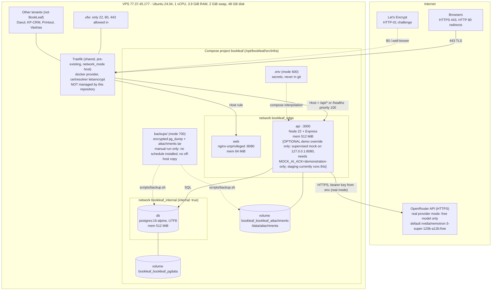
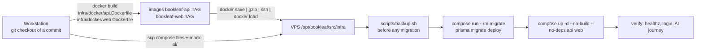

# 11. Deployment Architecture

Everything on this page was observed on the staging VPS during the release audit (2026-10-15/16) or read from `infra/`.
Where something was not observed it says so.

## 11.1 Topology

**What the diagram shows.**

* Only Traefik listens on the host (ports 80 and 443). The BookLeaf containers publish **no** host ports; PostgreSQL is on an `internal: true` network with no route outside the project, and only the API is attached to both networks.
* Routing is by Docker labels on the BookLeaf containers (`bookleaf-web`, `bookleaf-api` routers). The shared Traefik configuration is never edited. The API router has priority 100 and matches `Host(...) && (PathPrefix("/api/") || Path("/healthz"))`; everything else on that host goes to `web`. One origin means the `SameSite=Lax` session cookie is first-party.
* TLS is a real Let's Encrypt certificate for `bookleaf.77.37.45.177.sslip.io` (issuer Let's Encrypt, valid 2026-10-15 to 2027-01-13). Automatic renewal is performed by Traefik and was **not** observed.
* The API container has internet egress (required for real OpenRouter calls in production). The database does not.

## 11.2 Release flow (no source and no build on the server)

The server holds only `infra/` (compose files, Dockerfiles for reference, `mock-ai/`, `scripts/`, `.env`, `backups/`). The application source is not on the server, so images are built on a workstation from a known commit and loaded. Image tags used so far (`localtest`, `loginfix-20261015`) do not encode a commit, so traceability was established by building the commit cleanly and comparing the compiled output with the running containers (identical). The runbook now recommends tagging by short SHA.

## 11.3 Containers and configuration

| Item | Value (observed) |
| --- | --- |
| Compose project | `bookleaf` (files: `infra/docker-compose.yml`; opt-in `infra/docker-compose.demo.yml`) |
| Default services | `db`, `api`, `web`; one-shot `migrate`, `seed` under profile `tools` |
| Restart policy | `unless-stopped` on all long-running services |
| Health checks | `db` `pg_isready`; `api` fetches `/healthz`; `web` fetches `/` |
| Log rotation | `json-file`, 10 MB x 3 files per container |
| Memory limits | db 512 MiB, api 512 MiB, web 64 MiB. Observed use: db ~35 MiB, api ~120-155 MiB, web ~2 MiB |
| Persistent data | named volumes `bookleaf_bookleaf_pgdata` (~47 MB) and `bookleaf_bookleaf_attachments` (~76 KB at audit time) |
| Secrets | server-side `.env` (mode 600): `POSTGRES_PASSWORD`, `SESSION_SECRET`, seed passwords, optional `OPENROUTER_API_KEY`. Not in git; `.env.example` is the template |
| Demo AI | only when `docker-compose.demo.yml` is applied: the mock runs as a supervised process inside the API container. See [09 - AI Architecture](09-AI-ARCHITECTURE.md) |

## 11.4 Backup, restore and rollback

* `infra/scripts/backup.sh` writes a custom-format `pg_dump` and a tarball of the attachments volume to `backups/` (mode 700). **There is no schedule**: backups exist only because they were taken manually, and they live on the same disk as the data.
* Restore was proven in a disposable, network-isolated PostgreSQL container: all 10 compared tables matched the live row counts, the encoding was UTF8 and all 6 triggers were present. The live database was never restored into.
* Rollback: set the previous image tag (`BOOKLEAF_TAG` / `BOOKLEAF_WEB_TAG`) and recreate only that service; for the demo AI, drop the override file and recreate the API. Details in [infra/DEPLOY.md](../../infra/DEPLOY.md).

## 11.5 Host-level observations (outside this repository)

* The host reports a pending reboot and 23 security-related package upgrades.
* `/etc/cron.d` contains entries named `docker-image-prune` and `docker-builder-prune` (their contents were not inspected). If they prune unused images, a rollback image must stay referenced by a running container or another retained tag.
* The Aadya application (a different tenant) was removed from this host while the audit was running, by a root SSH session that was not part of the audit; it did not affect BookLeaf. Who was behind it is not established (see the VPS health report).
