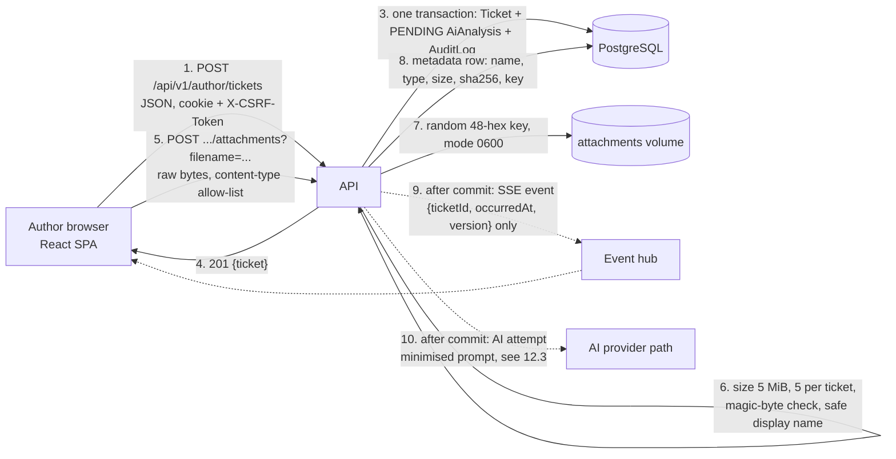
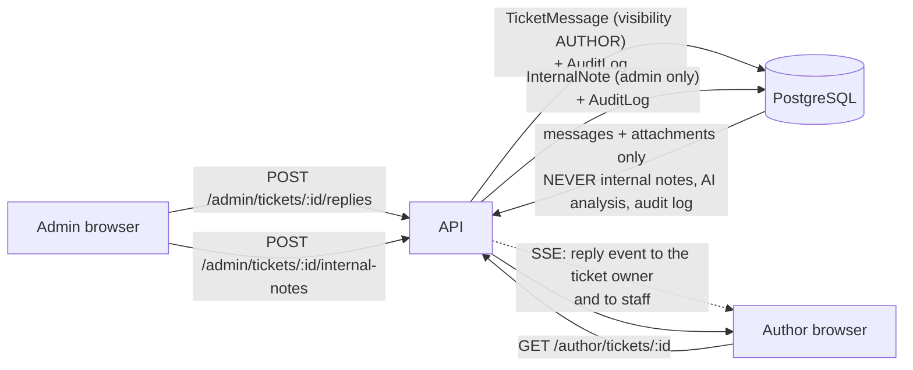
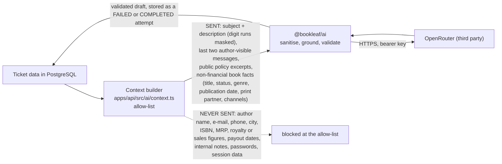

# 12. Data Flow Diagrams

These diagrams show where data goes, not how code is organised (see [05 - Backend](05-BACKEND-ARCHITECTURE.md) and [09 - AI](09-AI-ARCHITECTURE.md) for that). They were derived from the routes in `apps/api/src/routes/*` and verified against live behaviour.

## 12.1 Author creates a ticket with an attachment

Notes. The file bytes never touch the database and the storage key is not derivable from the file name. An SSE event carries identifiers and a version, never message text. Steps 9 and 10 happen after the commit, so a failure there cannot lose the ticket.

## 12.2 Admin replies, writes an internal note, and the author sees only the reply

Notes. Author endpoints build their responses from an allow-listed serializer; internal notes, AI analyses and audit events exist only on `/admin/*` endpoints. The live audit confirmed the author payload contained the reply text and no note text.

## 12.3 What leaves the system for AI (production path)

Notes. The test `9b` in `apps/web/e2e/01-journey.spec.ts` inspects the exact bytes sent to a mock provider and asserts the absence of the author's e-mail, phone, city, name, ISBN, internal note and every financial field name. In the staging demo the same path points at the in-container mock on `127.0.0.1`, so nothing leaves the host; its output is canned and labelled `[DEMO MOCK]` / `[DEMO DRAFT]` and goes through the same validation.

## 12.4 Data classification

| Store | Contents | Sensitivity | Protection observed |
| --- | --- | --- | --- |
| `User` | e-mail, argon2id password hash, role | High | hash prefix `$argon2id$` on all 11 rows; never serialised |
| `Session` | SHA-256 hash of the session token, expiry | High | token itself only in an `HttpOnly; Secure; SameSite=Lax` cookie; row deleted on logout |
| `AuthorProfile`, `Book` | name, phone, city, ISBN, royalty and sales figures | High (financial and personal) | author-scoped queries; cross-author access returns 404; excluded from AI context |
| `Ticket`, `TicketMessage` | support conversation | Medium | author-scoped; admin sees all |
| `InternalNote` | staff-only text | Medium | admin endpoints only; UPDATE rejected by trigger |
| `AiAnalysis` | classification, rationale, draft, citations, token cost | Medium | admin endpoints only; author never receives it |
| `AuditLog` | actor, action, entity, request id, `before`/`after` JSON | Medium | append-only by trigger. The JSON holds only identifiers and enum values (observed keys: `messageId`, `noteId`, `attemptId`, `assigneeId`, `category`, `priority`, `status`, `visibility`), never message text; the API exposes neither column |
| attachments volume | uploaded files | Medium-High | random keys, mode 0600, ownership checked in the lookup, forced-download headers |
| `backups/` | database dump, attachment tarball | High | mode 700 directory on the same disk; encrypted since 2026-10-16, daily cron installed, no off-host copy |
