# 13. Data Flow Levels, UML, Security, Backup and AI Provider Diagrams

Complements [12 Data flow diagrams](12-DATA-FLOW-DIAGRAMS.md) (concrete flows) with the formal DFD levels, the remaining UML views, and the security, backup and AI-provider architecture. Every element below was taken from the schema (`packages/db/prisma/schema.prisma`), the OpenAPI file and the source named in the neighbouring documents; the **backup** diagram describes scripts that exist in the repository but are **not installed on the VPS** (see §13.9).

## 13.1 DFD Level 0 (context)

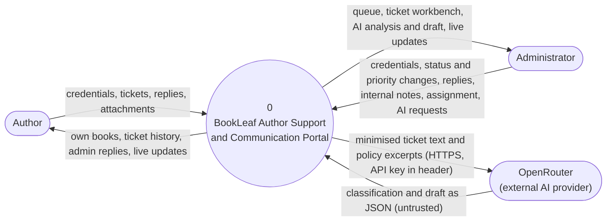

## 13.2 DFD Level 1

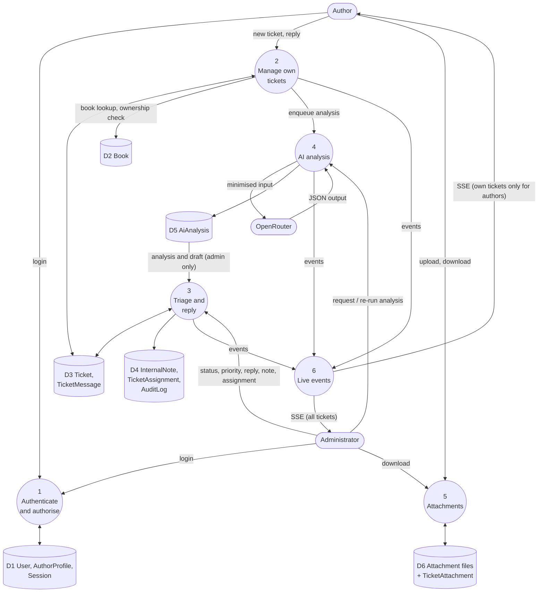

## 13.3 DFD Level 2: ticket workflow (process 2 and 3)

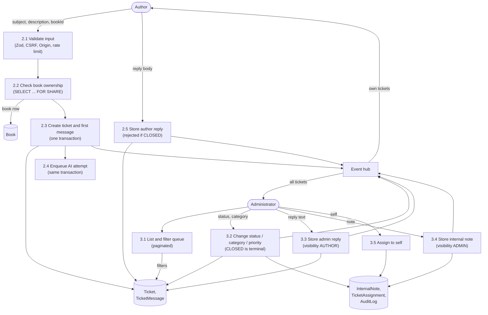

## 13.4 DFD Level 2: AI workflow (process 4)

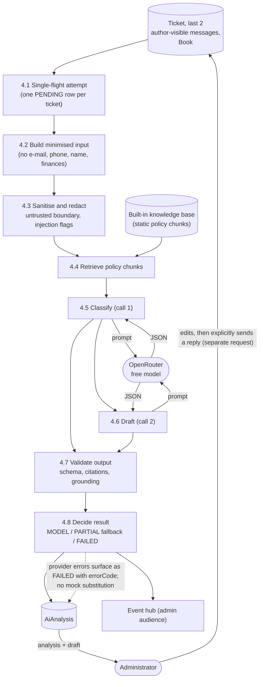

## 13.5 UML use case

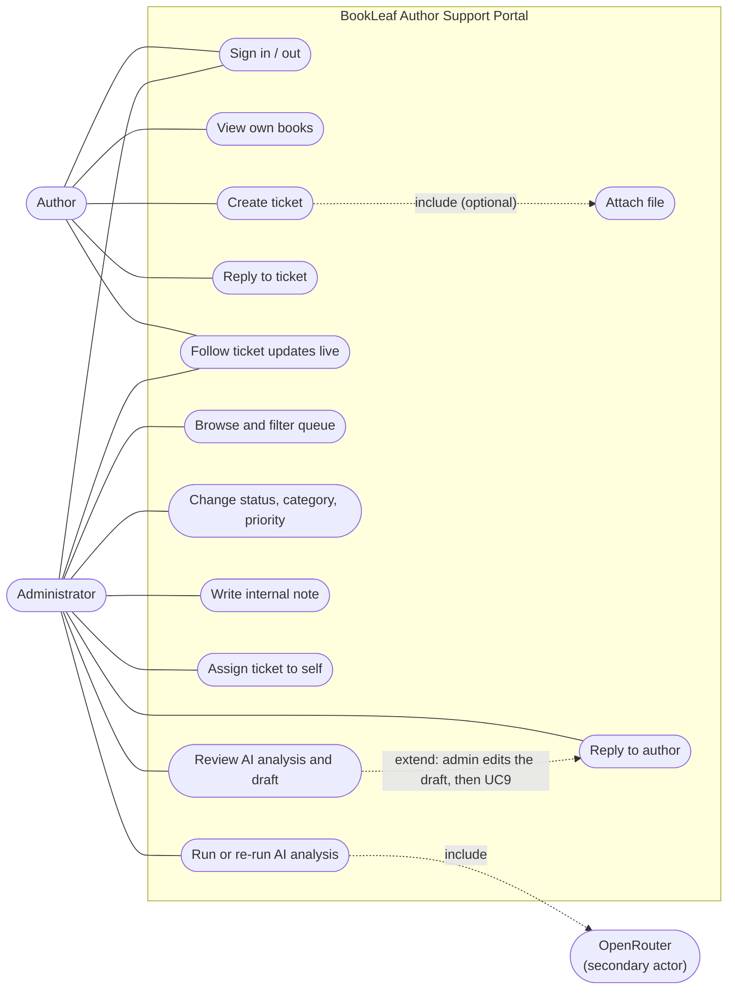

## 13.6 UML domain class diagram

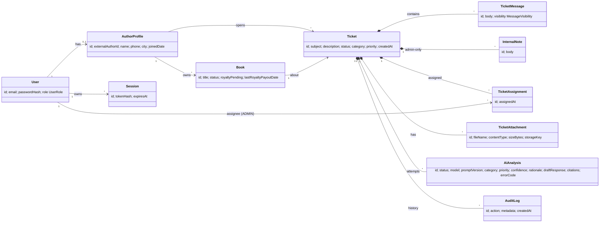

Attribute lists are abbreviated; the authoritative column list, types, keys and indexes are in [04 Data dictionary](04-DATA-DICTIONARY.md) and [03 Database ERD](03-DATABASE-ERD.md).

## 13.7 UML activity: administrator handles a ticket with AI

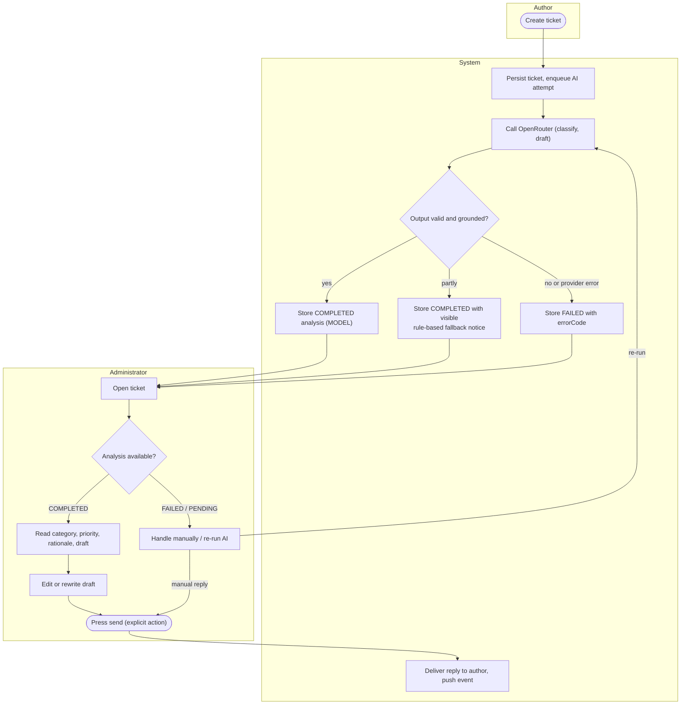

## 13.8 UML component and AI provider architecture

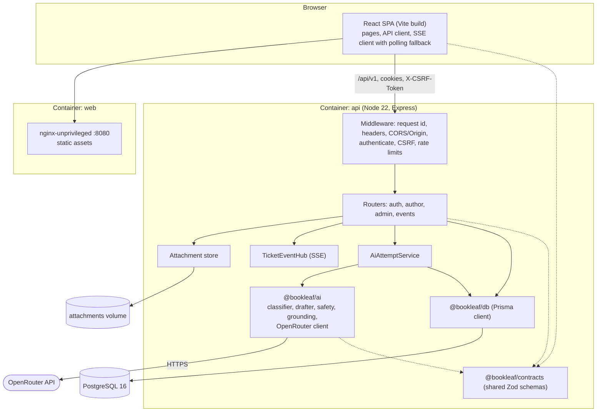

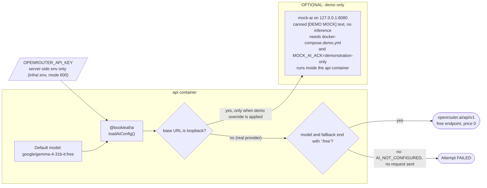

## 13.9 Security architecture

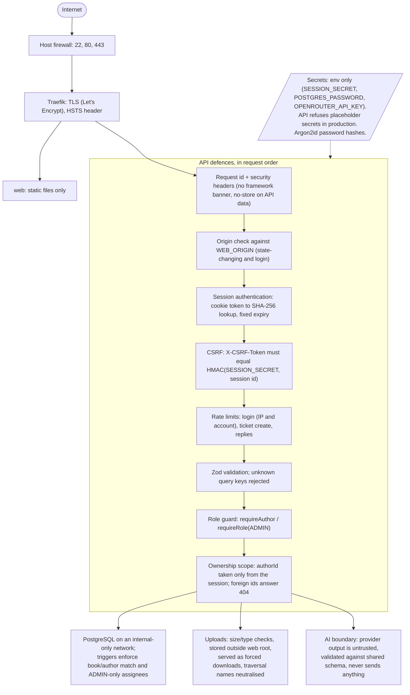

## 13.10 Backup architecture

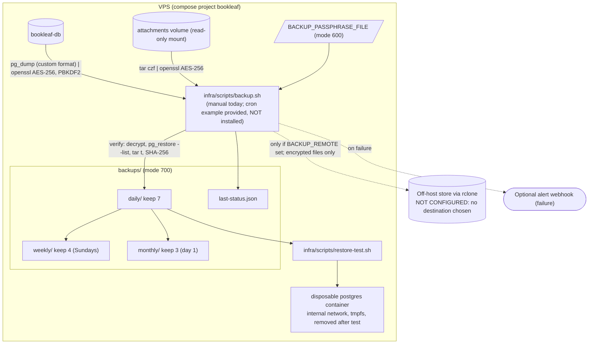

Status of the backup chain: the scripts were exercised locally against disposable containers (backup, checksum, restore of 550 rows, wrong passphrase and tampered archive rejected, retention pruning). They have **not** been installed on the VPS, no off-host destination exists, and no restore has been performed from a production backup.
