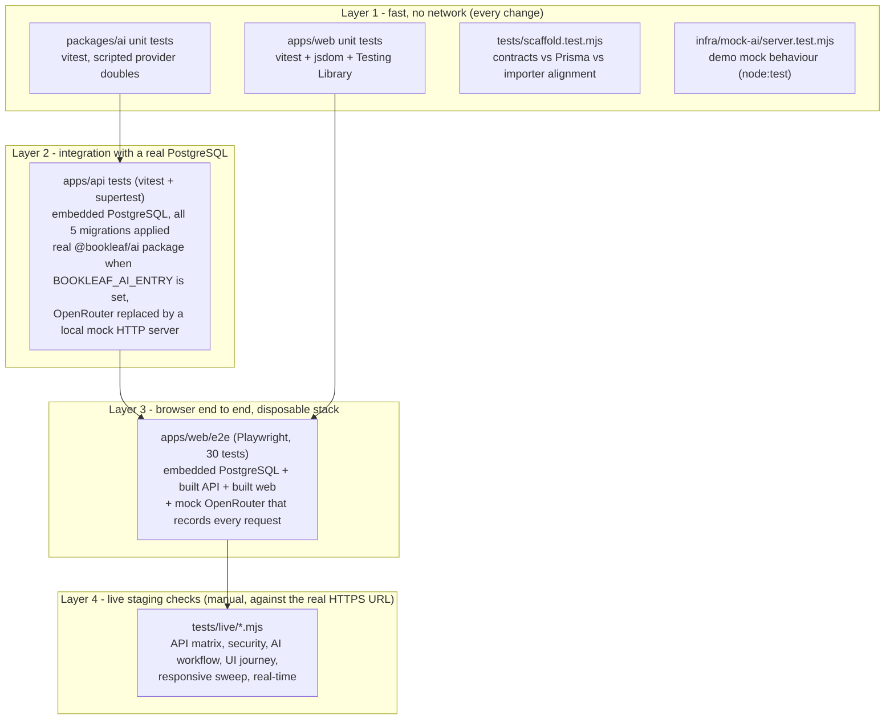

# 15. Testing Architecture

## 15.1 Layers

Layers 1 to 3 start their own throw-away services and use only synthetic data (`data/synthetic_seed.json` and fixtures); none of them contacts a paid API. Layer 4 talks to a deployed environment with the synthetic demo accounts, so it creates real (synthetic) tickets there.

## 15.2 Commands

| Command | Layer | Needs |
| --- | --- | --- |
| `npm run typecheck`, `npm run typecheck:e2e --workspace @bookleaf/web` | all | Node |
| `npm run build` | all | Node |
| `npm run test --workspace @bookleaf/ai` | 1 | Node |
| `npm run test --workspace @bookleaf/web` | 1 | Node |
| `npm run test:scaffold` | 1 | `npm run build` first |
| `npm run test:infra` | 1 | Node |
| `BOOKLEAF_AI_ENTRY=<absolute path>/packages/ai/dist/index.js npm run test --workspace @bookleaf/api` | 2 | `npm run build` first. **The path must be absolute**; without it the 11 real-package tests are skipped (the run still reports success) |
| `npm run test:e2e --workspace @bookleaf/web` | 3 | `npm run build`, a Chromium (`npx playwright install chromium` or `E2E_CHROMIUM_PATH`) |
| `node tests/live/<script>.mjs` | 4 | `BASE_URL` (default: the staging URL), `BL_AUTHOR_PW`, `BL_ADMIN_PW`; browser scripts also need Edge/Chromium. See [tests/live/README.md](../../tests/live/README.md) |

## 15.3 Latest fresh results (clean containers built from the repository, Linux)

| Suite | Node 22.23.3 | Node 24.22.0 |
| --- | --- | --- |
| Typecheck (+ e2e project), production build | pass | pass |
| AI package | 456 passed | 456 passed |
| API incl. real AI package (absolute `BOOKLEAF_AI_ENTRY`) | 227 passed, 0 skipped | 227 passed, 0 skipped |
| Web unit | 46 passed | 46 passed |
| Scaffold | 9 passed | 9 passed |
| Infra mock | 12 passed | 12 passed |
| Playwright E2E | 30 passed | 30 passed (after repairing the test image, see 15.5) |

The cross-version web fix is in `apps/web/src/test/setup.ts`: on Node 22 a fetch `Response.blob()` returns Node's native `Blob`, not jsdom's, so `instanceof Blob` assertions failed; the setup now returns the jsdom `Blob` as a browser does.

## 15.4 What each layer cannot show

* Layers 1-3 use a scripted or mock provider. They prove the pipeline (prompting, validation, grounding, persistence, review UI) and the privacy allow-list, **not** real-model output quality, latency or cost.
* There is no CI configuration in the repository (no `.github/`); the suites are run by hand. Nothing enforces them on a push.
* Layer 4 scripts are not part of `npm test`: they need a deployed target and credentials.
* No load, soak or accessibility tooling exists; browsers other than Chromium/Edge are not covered.

## 15.5 Test-environment pitfalls found during the audit

| Pitfall | Effect | Remedy |
| --- | --- | --- |
| `BOOKLEAF_AI_ENTRY` relative or unset | 11 tests skipped, run still green | use an absolute path |
| `.dockerignore` excludes `apps/web/e2e` (correct for production images) | an image built from the repo root has no E2E specs | use a separate ignore file for test images |
| Embedded PostgreSQL refuses to run as root | E2E and API tests fail in a root container | run as a non-root user |
| A truncated Playwright browser download (zero-byte files) | `browserType.launch ... browser has been closed` for every test | `npx playwright install chromium` again; check for zero-byte files under the browsers path |
| Windows: Prisma engine DLL locked by OneDrive/antivirus | `prisma generate` fails with `EPERM` | retry, or run in a container |
| Shared admin queue ordering (priority nulls last, oldest first, 25 per page) | a script that expects a new ticket on page 1 fails once ~25 tickets are open | open the ticket by id |
